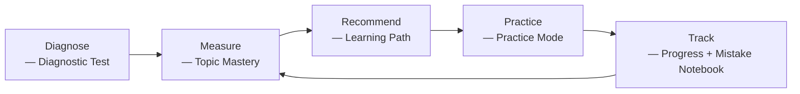

# TEMARIHUB — PRODUCT REQUIREMENTS DOCUMENT

> **"The system knows what you should study next."**
> An Ethiopian learning platform that stops guessing and starts measuring — built for Grade 12 students who don't just need more questions, they need to know which ones matter.

---

# PART I — PRODUCT

## 1. Document Information

| Field | Value |
|---|---|
| Product name | TemariHub |
| Document covers | **V1 only** ("Core Learning & Assessment") |
| Status | Draft — ready to build |
| Related docs | `API_CONTRACT.md`, `DATABASE_SCHEMA.md` (same folder) |

## 2. Product at a Glance

| | |
|---|---|
| **What it is** | An Ethiopian exam-prep platform that measures what a student actually knows, then tells them exactly what to study next. |
| **Who it's for (V1)** | Grade 12 Natural Science students preparing for the national entrance exam. |
| **Core promise** | "The system knows what the student should learn next." |
| **What V1 delivers** | Auth, curriculum, question bank, topic pages, diagnostic test, personalized learning path, practice mode, progress tracking, mistake notebook, dashboard, **RAG-grounded "Explain this" AI help** (§15.11, §28). |
| **What V1 does NOT deliver** | A full conversational, multi-turn AI tutor with memory, gamification, mock exams, payments — see §8 and §43. (V1's AI surface is deliberately narrow: one grounded explanation feature, not a chat companion.) |
| **Platforms** | Web + mobile (iOS & Android), one shared backend. |
| **Stack in one line** | Django + Django REST Framework + PostgreSQL backend, Next.js web app, React Native (Expo) mobile app. |

## 3. Executive Summary

Ethiopia already has several exam-prep apps. What none of them really do is tell a student **what to study next and why**. TemariHub V1 builds the foundation for that: a real curriculum structure (subject → unit → topic → concept), a well-tagged question bank, a diagnostic test that measures where a student actually stands, and a simple but real personalized learning path.

V1 is deliberately not flashy — no gamification, no mock exams, no chat-style AI tutor yet. But it does ship one real piece of AI, on purpose and early: a **Retrieval-Augmented Generation (RAG) "Explain this" feature** (§15.11, §28), grounded in TemariHub's own curriculum content, not a generic chatbot bolted on top. It's scoped narrow — one question in, one grounded answer out, no memory, no persona — specifically so it's buildable inside V1 without becoming the whole project. Everything else in this document is still the skeleton everything else in the product hangs off of. Get this right, and every future feature (a fuller AI tutor, streaks, mock exams, school dashboards) is just an addition. Get it wrong, and V2 becomes a rewrite.

## 4. Problem Statement

Ethiopian Grade 12 national exam pass rates are low — and it's **not** because students can't find practice material. Between PDFs, Telegram channels, textbooks, YouTube, and other quiz apps, questions are everywhere.

The real gap: **students don't know what they're weak at, what to study today, or how ready they actually are.** They're drowning in content with no map. TemariHub's job is to be the map.

## 5. Product Vision

Combine three things that already work well separately, and point them at one exam:

- **Brilliant-style** interactive, concept-first problem solving
- **Duolingo-style** daily habit and structure
- **Deep Ethiopian exam intelligence** — real past papers, real curriculum, real weighting of what actually gets tested

The long-term promise, and the entire reason this product should exist instead of another quiz app:

> **The system knows what the student should learn next.**

Everything in this document exists to make that sentence true.

## 6. Target Users

### Primary Persona — "Selam," the motivated Grade 12 student
- 17, final year of high school, Natural Science stream, in Addis Ababa or a regional town.
- Has a phone, sometimes shares a laptop; internet is not always reliable.
- Already has PDFs and a Telegram channel full of past exams — feels overwhelmed, not under-resourced.
- Wants: to know, in five minutes a day, exactly what to study and whether she's actually improving.
- Frustration: *"I've done a thousand questions. Am I even getting better?"*

### Secondary Persona — "Content Admin"
Someone on the founding team, wearing a different hat — not a separate real user in V1. Adds subjects/units/topics/questions through admin endpoints, since there's no admin UI yet. Needs question-entry to be fast and hard to get wrong (exactly one correct choice, always tagged to a topic).

### Not designed for in V1 (see §43 Future Scope)
Parents, teachers, school administrators, younger grades (9–11), Social Science stream.

## 7. Goals & Success Metrics

### Product Goals
- Prove that a measurement-first (not content-volume-first) approach to exam prep actually works for real students.
- Build a foundation V2 (AI tutor, gamification, mock exams) can be added onto without a rewrite.

### V1 Success Metrics

| Objective | How we'll know it worked |
|---|---|
| Students can get started with zero confusion | Under 3 minutes from signup to first question answered |
| Every student gets measured, not guessing | 100% of new users complete the diagnostic test |
| Students actually practice, not just browse | ≥ 5 practice questions answered per session, on average |
| Progress is visible and feels real | Dashboard shows live mastery + accuracy, not placeholder data |
| The codebase survives V2 | V2 features attach without breaking changes to V1's API or schema |

## 8. Non-Goals

- We are **not** trying to be a "we have 1 million questions" archive. Quality and structure beat volume.
- We are **not** replacing teachers, schools, or tutors. We're a study companion.
- We are **not** launching every grade at once. Grade 12 Natural Science first, on purpose.
- We are **not** adding gamification or monetization in V1 — those come once the core loop (diagnose → learn → practice → track) is proven.
- We are **not** building a full conversational AI tutor in V1 — no chat window, no multi-turn memory, no personality. V1's only AI surface is a narrow, RAG-grounded "Explain this" feature (§15.11) that answers one question at a time, grounded in TemariHub's own content. A richer tutor is V2 (§43), built on top of the same retrieval pipeline.
- We are **not** building separate native iOS and Android codebases — cross-platform (React Native) is the deliberate choice for a lean team.

## 9. Core Product Loop

Every feature in this PRD exists to run this one loop, over and over, getting a little more accurate each time:



Diagnose once, then keep looping through Measure → Recommend → Practice → Track. Every lap through the loop should leave the student's mastery numbers a little more accurate and a little higher — that's the entire product, underneath all the screens.

## 10. Product Principles

Short rules that should settle most "what should we do here?" arguments during the build:

1. **Structure before intelligence.** Get the curriculum graph, question tagging, and mastery model right first. AI is a layer on top, not a replacement for structure.
2. **Trust the source.** A student must always be able to tell a real past-exam question from a generated one. Never blur this to make the question bank look bigger.
3. **Measure, don't guess.** Every number shown to a student (mastery, accuracy, readiness) must be computed from real stored data — never hardcoded or estimated for show.
4. **Small and correct beats big and shaky.** One subject done properly beats five subjects half-built.
5. **Additive, not disruptive.** Every version should add to what exists, not replace it — this applies to the schema, the API, and the codebase alike.

---

# PART II — USER EXPERIENCE & REQUIREMENTS

## 11. User Journeys

### Journey A — First-time student (the most important journey in V1)
```
Register → Onboarding (grade + stream) → Diagnostic Test (sectioned by subject)
   → Diagnostic Results (strong/weak topics) → Dashboard (real data from day one)
```

### Journey B — Daily practice
```
Dashboard → "Recommended next" topic → Practice Session (filtered to that topic)
   → Answer question → See explanation → (if wrong) auto-saved to Mistake Notebook
   → Complete session → Progress + Mastery updated → back to Dashboard
```

### Journey C — Reviewing mistakes
```
Dashboard or Mistake Notebook tab → filter by subject/topic → "Practice My Mistakes"
   → starts a Practice Session pre-filtered to those questions
```

### Journey D — Exploring the curriculum directly
```
Browse Subjects → pick Unit → pick Topic → Topic Page (objectives, prerequisites, est. time)
   → "Practice this topic" or "Take mini assessment"
```

### Journey E — Asking "why is this wrong?" (RAG-grounded explanation)
```
Practice Session or Mistake Notebook → wrong answer shown → tap "Explain this"
   → system retrieves relevant curriculum content for that question's topic/concept
   → grounded explanation generated and shown, with a link back to the source topic
   → (if nothing relevant is on file) a clear "no explanation available yet" state — never a guess
```

## 12. User Stories

**Authentication**
- As a visitor, I can register with email, password, full name, and grade.
- As a user, I can log in and stay logged in without constantly re-entering my password.
- As a new user, I go through a short onboarding (grade + stream) before reaching my dashboard.

**Curriculum**
- As a student, I can browse Subjects → Units → Topics for my grade and stream.
- As a system, I understand which topics require which other topics first (prerequisites).

**Question Bank**
- As a student, I answer multiple-choice questions and immediately get feedback and an explanation.
- As a student, I can tell whether a question is from a real past exam or a generated practice question.

**Topic Pages**
- As a student, before studying a topic, I can see what it covers, what I need to know first, and how long it'll take.

**Diagnostic**
- As a new student, I take one diagnostic test covering all my subjects.
- As a student, right after finishing it, I see my strong and weak topics — not just a raw score.

**Learning Path**
- As a student, I see what to study next, what I've already mastered, and what's still locked.

**Practice**
- As a student, I can practice by subject, topic, or difficulty, and retry anything I got wrong.

**Progress**
- As a student, I can see my overall accuracy and how many topics I've completed.

**Mistakes**
- As a student, every question I get wrong is saved automatically so I can revisit it later.

**Dashboard**
- As a student, one screen shows me everything: progress, weak spots, and what to do next.

**AI Explanations (RAG)**
- As a student, when I get a question wrong, I can tap "Explain this" and get an explanation grounded in real curriculum content, not a generic guess.
- As a student, I can trust that an AI explanation either points back to real course material or honestly tells me nothing is available yet — it never makes something up.
- As the system, I log every explanation request so the team can see which topics are missing good source content.

## 13. Product Scope

### In Scope — V1 ("Core Learning & Assessment")

1. Student Authentication
2. Curriculum & Subjects
3. Question Bank
4. Topic Learning Specification
5. Diagnostic Test
6. Basic Personalized Learning Path
7. Practice Mode
8. Basic Progress Tracking
9. Mistake Notebook
10. Basic Student Dashboard
11. **RAG-Grounded Explanations ("Explain this")** — narrow AI help, grounded in real curriculum content (§15.11)

### Out of Scope for V1 (see §43 Future Scope)

Full conversational AI tutor (multi-turn chat, memory, personality, proactive hints beyond "Explain this"), gamification (XP/streaks/leaderboards/daily challenges), full timed mock exams, spaced repetition scheduling, parent/teacher/school dashboards, payments/subscriptions, Amharic AI explanations, offline mode, advanced mastery models (Bayesian Knowledge Tracing / IRT).

## 14. Functional Requirements

| ID | Requirement |
|---|---|
| FR-1 | The system shall let a user register with a unique email and a hashed password. |
| FR-2 | The system shall issue a short-lived access token and a longer-lived refresh token on login. |
| FR-3 | The system shall require grade + stream selection before showing curriculum content. |
| FR-4 | The system shall organize content as Subject → Unit → Topic → Concept. |
| FR-5 | The system shall allow a Topic to declare one or more prerequisite Topics. |
| FR-6 | The system shall store every question with exactly one correct choice, a difficulty level, a topic tag, and a source tag (official exam / AI practice / human authored). |
| FR-7 | The system shall never expose which choice is correct until a student submits an answer. |
| FR-8 | The system shall serve one diagnostic test, sectioned by subject, to every new student. |
| FR-9 | The system shall compute strong topics, weak topics, and an overall score once the diagnostic is submitted. |
| FR-10 | The system shall seed each student's initial mastery scores and learning path from their diagnostic results. |
| FR-11 | The system shall classify each topic for each student as Recommended, In Progress, Completed, or Locked. |
| FR-12 | The system shall compute "Locked" from the prerequisite graph plus the student's mastery on those prerequisites. |
| FR-13 | The system shall let a student start a practice session filtered by subject, topic, and/or difficulty. |
| FR-14 | The system shall record every practice answer (correct or not) as a practice attempt. |
| FR-15 | The system shall automatically save every incorrect answer into that student's Mistake Notebook. |
| FR-16 | The system shall let a student retry any question, in practice mode or from the Mistake Notebook. |
| FR-17 | The system shall compute progress (questions attempted, accuracy, topics completed) from stored attempts — never from a hand-maintained counter that can drift. |
| FR-18 | The system shall show one dashboard screen combining progress, weak topics, current topic, and a recommended next action. |
| FR-19 | The system shall store curriculum explanation content as topic/concept-tagged chunks, each with a vector embedding, in the shared Postgres database (via `pgvector`). |
| FR-20 | On an "Explain this" request, the system shall retrieve the most relevant stored content chunks for the question's topic/concept by vector similarity before generating any answer. |
| FR-21 | The system shall generate the explanation only from the retrieved chunks (retrieval-augmented generation) and shall never answer from the model's general knowledge alone. |
| FR-22 | The system shall return a clear "no explanation available yet" response, not a generated guess, whenever retrieval finds no sufficiently relevant content. |
| FR-23 | Every generated explanation shall be shown with a reference back to the topic/concept it was grounded in, so a student can always verify it against real course material. |
| FR-24 | The system shall log every explanation request (question, retrieved chunks, response, whether grounded or refused) for quality review and content-gap analysis. |
| FR-25 | The system shall rate-limit AI explanation requests per student to control third-party API cost and prevent abuse. |

## 15. Feature Specifications

Each feature below is a GitHub milestone; each story under it becomes its own GitHub issue.

### 15.1 Student Authentication
Registration (email + password + name + grade), login (JWT access + refresh), profile view/edit, password change, short onboarding (grade + stream) that gates curriculum content.
**Acceptance criteria:** passwords always hashed, never logged; duplicate email rejected clearly; access tokens expire and refresh cleanly; onboarding writes grade/stream to the profile.

### 15.2 Curriculum & Subjects
Subjects → Units → Topics → Concepts, starting with Grade 12 Natural Science (Math, Physics, Chemistry, Biology, English). Topics can declare prerequisite Topics (a graph, not a flat list). Students can browse the hierarchy.
**Acceptance criteria:** curriculum is seeded via a script, not hardcoded; a topic can have zero or more prerequisites; deleting/renaming a topic never orphans questions or mastery records.

### 15.3 Question Bank
Multiple-choice questions with prompt, 2–5 choices (exactly one correct), explanation, difficulty (1–5), estimated time, subject/unit/topic/concept tags, and a source tag (official exam / AI practice / human authored). Official exam questions record the exam year.
**Acceptance criteria:** an untagged question is never shown to a student; the source is always visible so students can trust what's a real past exam vs. generated practice; no AI generation pipeline yet, but the schema already supports it so V2 needs no migration.

### 15.4 Topic Learning Specification
A topic page showing what the topic is, its prerequisites, learning objectives, estimated study time, and recommended resources, with a direct jump into practice or a mini-assessment.
**Acceptance criteria:** this is a read endpoint that composes curriculum + question count — not a duplicate data table.

### 15.5 Diagnostic Test
One fixed, versioned test per student, sectioned by subject (roughly proportional across Math/Physics/Chemistry/Biology/English). Answers are hidden until submission. On completion, the system reports strong topics, weak topics, and an initial performance level per subject, and seeds initial mastery + learning path data.
**Acceptance criteria:** deterministic question set (not randomly regenerated, for fairness); every answer records time spent and correctness; completing it is what unlocks a populated (non-empty) dashboard and learning path.

### 15.6 Basic Personalized Learning Path
Topics grouped as Recommended, In Progress, Completed, Locked. "Locked" comes from the prerequisite graph + mastery on those prerequisites. "Recommended" in V1 is a simple rule: unlocked topics ordered by lowest mastery first.
**Acceptance criteria:** no ML model in V1 — a small, deterministic rules module that can be swapped for something smarter in V2 without changing the API; prerequisite progression updates automatically as mastery crosses into "Strong" or above.

### 15.7 Practice Mode
Start a session filtered by subject/topic/difficulty, answer questions, see correct answers and explanations, retry anything wrong.
**Acceptance criteria:** every answer is recorded as a practice attempt (feeds progress + mistakes); no timer or exam-integrity rules yet (that's V2's Real Exam Mode).

### 15.8 Basic Progress Tracking
Questions attempted, correct/incorrect counts, overall accuracy, topics completed, per-subject progress.
**Acceptance criteria:** always computed from stored attempts/responses — never a hand-maintained counter that can silently drift.

### 15.9 Mistake Notebook
Every wrong answer (practice or diagnostic) is automatically saved with the student's answer, the correct answer, the explanation, topic, and difficulty. A "Practice My Mistakes" button starts a filtered practice session.
**Acceptance criteria:** created automatically on any incorrect attempt — no manual "save this mistake" action required.

### 15.10 Basic Student Dashboard
One screen: current progress, weak topics, questions completed, accuracy, current learning topic, recommended next activity.
**Acceptance criteria:** this is a read-only aggregator over the features above — it owns no data of its own, so adding V2 features (streaks, XP) later is purely additive.

### 15.11 RAG-Grounded Explanations ("Explain this")
A single-turn AI help feature, available from a practice question, a diagnostic question review, or a Mistake Notebook entry. The student taps "Explain this"; the system retrieves the most relevant chunks of TemariHub's own curriculum content (topic write-ups, worked solutions) for that question's topic/concept, then generates one explanation grounded strictly in those chunks — see §28 for the full pipeline. No chat window, no follow-up questions, no memory of past requests: one grounded answer per tap, shown with a link back to the source topic.
**Acceptance criteria:** every explanation is traceable to specific retrieved content, never generated from the model's general knowledge alone; when nothing relevant is found, the student sees an honest "not available yet" state, never a fabricated answer; every request (and whether it was grounded or refused) is logged for content-gap review; per-student request rate is limited to control API cost.

## 16. Business Rules

- A question must have **exactly one** correct choice — enforced in the service layer and, ideally, a database check.
- A question is never returned to a student without a topic tag.
- A student cannot see whether an answer is correct until they submit it (applies to both practice and diagnostic).
- The diagnostic test is fixed per version — it is not randomly regenerated per student.
- A topic is "Locked" for a student until every one of its prerequisite topics reaches at least the "Strong" mastery band.
- Every incorrect answer, in any mode, automatically creates a Mistake Notebook entry — this is not optional or user-triggered.
- Mastery bands (used across the product): `starting` (0–20%), `learning` (20–40%), `developing` (40–60%), `strong` (60–80%), `mastered` (80–95%), `exam_ready` (95%+).
- Official exam questions must always carry an exam year; AI/human-authored practice questions never claim to be from a real exam.
- An "Explain this" response must always be grounded in retrieved curriculum content — if retrieval returns nothing sufficiently relevant, the system refuses with a clear message instead of generating an ungrounded answer.
- Every AI explanation request is logged (query, retrieved chunks, response, grounded/refused) — this is not optional, and is the primary signal for where curriculum content needs to be written or improved.

## 17. UX Requirements

- **Mobile-first:** design every screen for a phone first, then adapt it for a wider web screen — most students will use this on a phone.
- **Instant feedback:** every practice answer shows correct/incorrect immediately, paired with an icon (checkmark/cross), not color alone.
- **No dead ends:** an empty state (no questions yet for a filter, no mistakes yet) always shows a clear next action, never a blank screen.
- **Minimal steps to the point:** from opening the app, a returning student should reach "what should I study today" in one tap (the dashboard).
- **Consistent visual language across web and mobile:** same color meanings, same icons, same terms (e.g. always "Practice," never sometimes "Quiz" and sometimes "Practice").
- **Loading states, not frozen screens:** anything that takes more than ~300ms (diagnostic scoring, dashboard load) shows a loading indicator.

## 18. Error & Edge Cases

- Registering with an email that's already taken → clear, specific error, not a generic failure.
- Submitting an answer to a practice session or diagnostic that's already been marked complete → rejected.
- Starting a diagnostic test a second time after already completing one → either block it or clearly mark it as a retake (decide before building — see §44 Open Questions).
- Starting a practice session with filters that match zero questions (e.g. a brand-new topic with no questions yet) → return a clear "no questions available" response, not an empty crash.
- A topic's prerequisite topic gets deleted or restructured by the content admin → must not silently break the "Locked" calculation; prerequisite links should be checked/cleaned up as part of any curriculum edit.
- Network drops mid-practice-session on a slow connection → the session and any already-recorded attempts should not be lost; only the in-flight, unsent answer is at risk.
- A question somehow has zero or more than one correct choice due to a data-entry mistake → this should be prevented at write time, not discovered by a confused student.

## 19. Accessibility

- Text should stay legible at normal phone screen sizes — no critical information in tiny fine print.
- Never rely on color alone to show meaning (e.g. pair "correct" green with a checkmark icon, "incorrect" red with a cross icon), so colorblind students aren't lost.
- Tap targets (buttons, choices) should be large enough to tap accurately on a small screen — don't cram options too close together.
- Interactive elements should have clear, readable labels (helps both low-vision users with screen readers, and just general clarity for everyone).
- The app should stay usable on older, lower-spec Android phones, which are common in this market — avoid heavy animations or effects that make the app feel sluggish.

## 20. Analytics

| Event | Why we track it |
|---|---|
| `user_registered` | Funnel: how many people start |
| `onboarding_completed` | Funnel: how many pick grade/stream |
| `diagnostic_completed` | Core success metric — should approach 100% of registered users |
| `practice_session_completed` (+ question count) | Engagement — target ≥5 questions/session average |
| `dashboard_viewed` | Are students actually coming back to check progress? |
| `topic_mastery_band_changed` | Are students actually improving, not just answering? |

---

# PART III — DATA & TECHNICAL DESIGN

## 21. Technical Requirements

High-level technical mandates that everything else in this part follows from:

- One backend API must serve **both** the web app and the mobile app — no duplicate business logic written twice.
- One general PostgreSQL schema must serve **every** version (V1, V2, V3...) — extended additively, never forked per version (see §25).
- The system must stay usable on slow or unstable mobile connections — keep API payloads small, avoid over-fetching unused fields.
- The design already implements a grounded (RAG) retrieval + generation pipeline in V1 (see §28), and must leave a clear, documented path for V2 to extend it (multi-turn tutor, Amharic) without reworking V1's schema or API.
- Every schema change and every API change must be reflected in `DATABASE_SCHEMA.md` / `API_CONTRACT.md` in the same pull request that makes the change — the docs are not allowed to drift from the real code.

## 22. System Architecture

```
   [ Next.js Web App ]     [ React Native Mobile App ]
            \                        /
             \                      /
              \                    /
            [ Django + DRF Backend — one REST API ]
                        |
              [ Domain Service Layer ]
       (identity, curriculum, content, assessment,
        learning_path, practice, progress, mistakes,
        dashboard, ai_tutor)
                        |
              [ PostgreSQL + pgvector — one schema ]
                        |
        ai_tutor domain also calls out to:
     [ Embedding API ] and [ LLM Generation API ]
      (retrieval happens in Postgres; only the
       final grounded prompt leaves the backend)
```

Both frontends talk to the same backend through the same API contract — no separate "mobile API" or "web API." The backend itself is organized by domain (see §24), not by technical layer, so features stay easy to reason about as the codebase grows. The `ai_tutor` domain is the one domain that talks to an external AI provider — every other domain stays fully self-hosted.

## 23. Technology Stack

Picked because it fits a small team building an education product that needs AI later and serves users on patchy connections — not because it's familiar to anyone specific.

**Backend — Python + Django + Django REST Framework (DRF)**
Django is a "batteries-included" framework — ORM, migrations, auth, and (crucially, see below) an admin panel all come built in and maintained as one cohesive project, instead of separately-chosen pieces to wire together. That matters for a lean team: less setup, fewer decisions to make just to get moving. The same AI-later argument still holds too — Python has the richest AI/ML tooling, so adding AI features in V2 never means switching languages. DRF sits on top of Django to make building a clean REST API straightforward.
- **Django's built-in Admin panel** gives the Content Admin persona (§6) a real, working screen for creating and editing curriculum and questions almost for free — this actually answers one of the open questions in §44 (whether V1 needs a lightweight admin UI) without extra build time.
- **Django ORM** — built into Django itself, no separate library needed; same idea as before (Python objects turn into database rows and back).
- **DRF Serializers** — define the exact shape of every request/response and validate data automatically, rejecting anything malformed before it reaches business logic.
- **Django's migration system** (`makemigrations` / `migrate`) — every schema change becomes a versioned file everyone on the team applies with one command, built directly into the framework.
- **Auth:** `djangorestframework-simplejwt` for JWT access + refresh tokens; passwords hashed automatically by Django's built-in password hashers (PBKDF2 by default, swappable for bcrypt/argon2).
- **API docs:** `drf-spectacular` auto-generates a live, browsable OpenAPI/Swagger page straight from the code — the same "docs can't go stale" benefit as before.
- **Testing:** `pytest-django` for automated tests; **Docker** so the app runs identically on every machine.
- **Server:** Gunicorn (the standard production server for Django), typically behind Nginx — most managed hosts (see below) handle this setup for you.
- **RAG (§28):** `pgvector` as a Postgres extension for vector storage/similarity search — no separate vector database to run and pay for; `django-pgvector` (or raw `VectorField`/SQL via the Django ORM) to store and query embeddings from the same models as everything else. An embeddings provider (e.g. Voyage AI, which Anthropic recommends for use alongside Claude) turns content chunks and student questions into vectors; the Anthropic Python SDK (`anthropic`) calls Claude to generate the grounded answer from the top retrieved chunks. Both calls are wrapped in the `ai_tutor` domain's service layer (§24) — nothing elsewhere in the codebase talks to an external AI API directly.

**Database — PostgreSQL (with `pgvector`)**
Enforces relationships with foreign keys — the database itself refuses to save broken links (like a question pointing to a topic that doesn't exist). Free, well-supported managed hosting is easy to find. The `pgvector` extension adds a native vector column type and similarity search directly inside the same Postgres instance already used for everything else — one database to run and back up, not a separate vector-database service.

**Web app — Next.js + TypeScript**
The standard modern choice for an app with both public pages and interactive logged-in pages. TypeScript catches a large class of bugs while typing, before the app ever runs — valuable whenever more than one person is editing shared code.
- **Tailwind CSS + shadcn/ui** for styling and ready-made, editable components.
- **TanStack Query** to handle loading/error states and re-fetching automatically.

**Mobile app — React Native + Expo**
Uses the same language (TypeScript) as the web app, so code, types, and the API client can be shared instead of duplicated. Expo's cloud build service (EAS Build) builds the iOS app without needing a Mac. Flutter (the main alternative) is a bit faster for heavy animation — which this product doesn't need.
- **NativeWind** (Tailwind syntax for React Native), **React Navigation**, same TanStack Query pattern as web.

**Keeping it all in sync:** `drf-spectacular` publishes a machine-readable API description (an OpenAPI schema). Run **openapi-typescript** against it to auto-generate matching TypeScript types for both the web and mobile app — if the backend renames a field, both frontends show a compile error immediately instead of a silent bug reaching a real student.

**Hosting (cheap, low-maintenance):**

| Layer | Host | Why |
|---|---|---|
| Backend | Render or Railway | Free/cheap tier, deploys straight from GitHub, runs Docker without extra setup |
| Database | Neon or Supabase | Free tier, fully managed Postgres — both support the `pgvector` extension needed for RAG (§28) with no extra service to provision |
| Web app | Vercel | Free tier, auto-deploys on every merge to `main` |
| Mobile builds | Expo EAS | Cloud builds for iOS + Android, no Mac needed |

## 24. Domain Architecture

Backend is organized **domain-first** (not by technical layer), so each domain is a self-contained vertical slice:

```
backend/app/
  core/                 # config, db session, security/JWT
  domains/
    identity/           # Authentication
    curriculum/          # Subjects/Units/Topics/Concepts + prerequisites + topic spec
    content/              # Question Bank
    assessment/           # Diagnostic Test
    learning_path/        # Recommendation rules engine
    practice/             # Practice sessions & attempts
    progress/             # Progress aggregation
    mistakes/             # Mistake Notebook
    dashboard/            # Read-only aggregator over everything above
    ai_tutor/             # RAG: content chunking, embeddings, retrieval, grounded generation
  api/v1/router.py        # mounts every domain router
```

**Rule:** a domain may call another domain's **service layer** (a function call), but must never reach directly into another domain's database models. `learning_path` and `dashboard` are the two domains allowed to depend on almost everything else, since aggregating is their whole job. `ai_tutor` is the third exception, in one direction only: it reads from `curriculum` and `content` (to know what a question's topic/concept is and to pull grounding chunks), but no other domain ever calls into `ai_tutor` directly except through its public "explain this question" service function — and `ai_tutor` is the **only** domain permitted to make outbound calls to an external API (§27).

## 25. Data Architecture

Full schema, table-by-table, lives in **`DATABASE_SCHEMA.md`** — this is the short version.

Core entities: `users`, `subjects` → `units` → `topics` → `concepts`, `topic_prerequisites`, `questions` + `question_choices`, `diagnostic_tests` + `diagnostic_responses`, `practice_sessions` + `practice_attempts`, `topic_mastery`, `learning_path_items`, `mistakes`, and — new in V1 for RAG (§28) — `content_chunks`, `content_chunk_embeddings` (`pgvector` column), `tutor_queries`, `tutor_responses`.

**Design principle:** one general schema shared by every version, extended additively (new tables/columns), never redesigned per version. The RAG tables follow the same rule: `content_chunks` and `content_chunk_embeddings` are tagged by the same stable topic/concept IDs everything else uses, so V2's fuller AI tutor extends this data, it doesn't replace it — see `DATABASE_SCHEMA.md` for the exact rule and the full ER diagram.

## 26. API Architecture

Full endpoint-by-endpoint contract lives in **`API_CONTRACT.md`**. Endpoint groups: `/auth`, `/curriculum`, `/questions`, `/diagnostic`, `/practice`, `/learning-path`, `/progress`, `/mistakes`, `/dashboard`, `/ai-tutor` (§15.11, §28 — a single `POST /ai-tutor/explain` endpoint in V1, rate-limited per student).

- REST over JSON, versioned under `/api/v1` so a future `/api/v2` can be introduced without breaking existing clients.
- Consistent error shape and pagination style across every endpoint (see `API_CONTRACT.md` conventions).
- No third-party integrations in V1 — no payment gateway, no external notification provider. That's intentionally a V2+ concern (§43).

## 27. Security & Privacy

- Passwords are always hashed (bcrypt) — never stored, logged, or transmitted in plain text.
- All traffic over HTTPS, no exceptions, including in development against staging.
- JWT access tokens are short-lived; refresh tokens renew a session without re-entering a password, and should be revocable (e.g. on password change).
- Rate-limit login and registration endpoints to slow down brute-force attempts.
- Store only the personal data actually needed to run the product: email, name, grade, stream. No unnecessary personal data collection.
- A student can only ever see their own progress, mastery, mistakes, and dashboard data — never another student's.
- Content-admin actions (creating/editing questions and curriculum) are restricted to the `admin` role.
- The `ai_tutor` domain (§24, §28) is the only part of the system allowed to send data to a third-party API. Only the question text, the retrieved curriculum chunks, and the minimum needed context are sent — never the student's name, email, or other personal data — and every outbound call goes through this one domain, never called directly from another domain or a frontend.
- AI explanation requests are rate-limited per student (FR-25) both to prevent abuse and to keep third-party API cost predictable.

## 28. AI / RAG Architecture

**V1 ships one real AI feature, and it's RAG from day one** — "Explain this" (§15.11). There is still no AI-generated question content, no chatbot persona, and no machine-learning mastery model; mastery stays a simple accuracy-based score, and the learning path stays a deterministic rule (§15.6). The one place AI shows up is grounded explanations, and it's built the safest way possible: **Retrieval-Augmented Generation**, not an AI answering from general training. Instead of guessing, the system first looks up TemariHub's own curriculum content (explanations, worked solutions, topic write-ups) relevant to the student's question, then generates an answer grounded only in that content — so answers stay accurate to the actual Ethiopian curriculum instead of invented.

### 28.1 Why RAG (not fine-tuning, not a bare LLM call)
- A bare LLM call risks hallucinated facts, wrong formulas, or answers that don't match how the topic is actually taught here — unacceptable for exam prep.
- Fine-tuning a model on curriculum content is slow to update (every content fix needs retraining) and expensive for a small team. RAG content is just rows in Postgres — editable instantly, no retraining.
- RAG also gives a natural refusal path: if nothing relevant is retrieved, the system says so honestly (FR-22, Business Rules §16) instead of generating a plausible-sounding guess.

### 28.2 The pipeline, end to end (Django, `ai_tutor` domain, §24)

**A — Ingestion (content prep, ongoing from Week 1):**
1. Curriculum content (topic write-ups, worked solutions, explanations already being written for §15.2/§15.3/§15.4) is split into small, focused chunks — roughly one idea or one worked step per chunk, not whole pages.
2. Each chunk is stored in `content_chunks`, tagged with its topic/concept ID (§25) — the same stable IDs everything else in the schema uses.
3. A management command (`python manage.py embed_content`) sends new/changed chunks to the embeddings provider and stores the resulting vector in `content_chunk_embeddings` (a `pgvector` column via `django-pgvector`/`VectorField`). Re-run whenever content changes — embeddings are cheap and fast to regenerate.

**B — Retrieval (on every "Explain this" request):**
1. The student's question (plus the topic/concept it's tagged to, from the question bank — FR-6) is embedded with the same embeddings provider.
2. A `pgvector` cosine-similarity query against `content_chunk_embeddings`, filtered to that topic/concept first, returns the top-k most relevant chunks — all inside a single Postgres query, no separate vector database to run.
3. If nothing clears a minimum similarity threshold, the pipeline stops here and returns the "not available yet" refusal (FR-22) — the LLM is never called on an empty or weak retrieval, which also saves cost.

**C — Generation (grounded, only when retrieval succeeds):**
1. The retrieved chunks are assembled into a prompt that explicitly instructs the model to answer **only** from the provided material and to say so plainly if the material doesn't fully cover the question.
2. The prompt is sent to Claude (Anthropic API, via the `anthropic` Python SDK) to generate the explanation.
3. The response, the retrieved chunk IDs, and the originating question are all saved to `tutor_responses`/`tutor_queries` (FR-24) — this log is both a quality/audit trail and the single best signal for "which topics need better source content written."
4. The explanation is returned to the student with a reference back to the source topic (FR-23), so it's always checkable against real material.

### 28.3 What this keeps cheap and safe for a lean team
- **One database, not two:** `pgvector` lives inside the same Postgres instance (§23) already running for everything else — no separate vector-database service to provision, pay for, or keep in sync.
- **Cost control built in, not bolted on:** retrieval-before-generation means the (paid) LLM call only happens on a real, groundable question; per-student rate limiting (FR-25) caps worst-case spend.
- **No prompt injection surface into other domains:** `ai_tutor` is the only domain allowed to call an external API (§24, §27) — every other domain stays fully self-hosted and untouched by this.
- **Additive to the schema, not disruptive (Principle 5, §10):** `content_chunks`/`content_chunk_embeddings`/`tutor_queries`/`tutor_responses` are new tables that reference existing topic/concept IDs — nothing about V1's existing tables changes.

### 28.4 What's deliberately still deferred to V2 (§43)
- Multi-turn conversation / memory across requests — V1 is strictly one question in, one grounded answer out.
- Amharic explanations — V1 ships English-only; the chunking/embedding pipeline is language-agnostic, so this is a content + embeddings-provider question later, not a redesign.
- Personalizing explanation depth/difficulty by the student's mastery band (§46) — V1's prompt is the same for everyone.
- A smarter retrieval strategy (re-ranking, hybrid keyword+vector search) if plain cosine similarity proves too coarse once there's real usage data from `tutor_queries`.

## 29. Non-Functional Requirements

- **Performance:** API responses should return in under 500ms for normal requests (dashboard, practice) under expected V1 load.
- **Availability:** the app should stay reachable whenever a student opens it — no scheduled downtime during evening study hours (roughly 5pm–11pm local time).
- **Scalability:** the system should handle growth from tens to a few thousand students without a redesign — no hardcoded limits baked into the database or API.
- **Low-bandwidth friendliness:** keep API responses small, keep the mobile app's install size and image sizes small — Ethiopian mobile data can be slow or unreliable.
- **Maintainability:** the codebase must let people work on different parts without constantly stepping on each other — this is exactly why the backend is organized by domain (§24).
- **AI explanation latency:** "Explain this" (§15.11, §28) involves an external API call and can reasonably take a few seconds — show a loading state (§17), don't block the rest of the app, and don't hold it to the same <500ms bar as core CRUD endpoints.
- **AI explanation cost:** third-party embedding/generation API spend must stay predictable — enforced via retrieval-before-generation and per-student rate limiting (FR-22, FR-25), monitored against a monthly budget (§42).

---

# PART IV — ENGINEERING & DELIVERY

## 30. Repository Structure

Recommended: **one monorepo**, not separate repos per app — simplest for a small team to keep everything in view and in sync.

```
temarihub/
  backend/     # Django + DRF app (see §24 for internal structure)
  web/         # Next.js app
  mobile/      # Expo/React Native app
  docs/        # this PRD, API_CONTRACT.md, DATABASE_SCHEMA.md
  .github/     # workflows (CI), issue/PR templates
```

A single PR can touch backend + web together when a feature genuinely spans both, without juggling three separate repos and three separate PRs for one feature.

## 31. Git & GitHub Workflow

Rules so work never collides and `main` always stays deployable.

**1. Every task starts as a GitHub Issue.** Turn the relevant Feature Spec (§15) story into an issue before writing code — title short and specific, labeled by domain (`domain:curriculum`, `domain:practice`, etc.) and type (`type:feature`, `type:bug`, `type:chore`), with acceptance criteria copied from the PRD. No untracked work — if it's not an issue, don't start it.

**2. Always branch from an up-to-date `main`.**
```bash
git checkout main && git pull origin main
git checkout -b feat/domain-short-description
```
Never branch off another feature branch. One branch per issue. Branch naming: `<type>/<domain>-<description>` (e.g. `feat/diagnostic-scoring`, `fix/practice-retry-duplicate-attempt`).

**3. Commit with Conventional Commits** (`feat(diagnostic): compute strong/weak topics on completion`) — small, frequent commits over one giant one at the end.

**4. Never push straight to `main` — always open a PR.** Link the issue (`Closes #12`), and include: what changed, how to test it, and a checklist (migration added if schema changed, `API_CONTRACT.md` updated if the endpoint shape changed, tests added, lint passes). `main` should be protected in GitHub settings: no direct pushes, PR + at least one approving review + passing CI required.

**5. Review before merge.** Every PR is reviewed by someone other than its author — no self-merging. The reviewer checks: does it match the acceptance criteria, does it respect the domain boundary rule (§24 — no reaching into another domain's models directly), and is any schema change additive rather than destructive (per `DATABASE_SCHEMA.md`)?

**6. Squash-merge into `main`**, then auto-delete the branch — keeps history to one clean commit per issue.

**7. Minimum CI pipeline** (GitHub Actions, required to pass before merge): install deps → lint (`ruff` for backend, `eslint` for frontend) → run tests (`pytest-django` / frontend test suite).

**8. Keep your branch current** if `main` moves while you're mid-feature: `git checkout main && git pull`, then `git checkout <your-branch> && git rebase main`, resolve conflicts, `git push --force-with-lease`.

## 32. Development Standards

- **Formatting/linting:** `ruff` (Python) and `eslint` + `prettier` (TypeScript) — run automatically, not manually remembered.
- **Type safety:** Python type hints checked with `mypy` (or at least enforced via DRF serializers everywhere data crosses a boundary); TypeScript run in `strict` mode.
- **Naming:** consistent, descriptive names across backend and frontend — the same concept should have the same name everywhere (e.g. always `topic_id`, never `topicId` in Python and `topic_id` in one place, `tid` in another).
- **Commits:** Conventional Commits style (`feat(diagnostic): ...`, `fix(practice): ...`) — makes history and changelogs easy to scan later.
- **Code review:** every PR reviewed by someone other than its author before merge — no self-merging, regardless of urgency.

## 33. Testing Strategy

- **Unit tests** per backend domain module (identity, curriculum, content, assessment, learning_path, practice, progress, mistakes) — `pytest`.
- **Integration/API tests** for every endpoint in `API_CONTRACT.md`, including the error cases in §18 (duplicate email, no questions available, etc.) — `pytest-django` + DRF's `APIClient`.
- **Manual QA checklist** before each release: walk through Journeys A and B (§11) by hand on both web and mobile, at least once on a throttled/slow connection.
- **Seed data:** a repeatable seed script for curriculum + a real question set is required before any of the above tests are meaningful — treat it as its own ticket, not an afterthought.

## 34. CI/CD

- **GitHub Actions** runs lint + tests on every pull request — a PR cannot merge if these fail (see §31).
- **Continuous deployment on merge:** Vercel redeploys the web app automatically on every merge to `main`; Render/Railway can be configured to do the same for the backend.
- **Mobile builds** are not continuous — trigger an Expo EAS build manually (or on a version tag) when a new mobile release is actually ready to submit to app stores.

## 35. Environment Configuration

- Three environments: **local** (developer machine), **staging** (for internal alpha/beta testing, §39), **production** (real students).
- Configuration (database URL, JWT secret, API base URL, etc.) is provided through environment variables — never hardcoded, never committed to Git.
- Each environment has its own database — staging data must never be able to reach production, and vice versa.

## 36. Deployment

- Push to `main` → CI runs lint + tests → on success, web (Vercel) and backend (Render/Railway) auto-deploy.
- Database migrations (Django's `migrate` command) run as an explicit step in the deploy pipeline — never applied by hand against production.
- **Rollback:** both Vercel and Render/Railway keep previous deployments and support redeploying an earlier one in a couple of clicks if something breaks — always confirm this works before you need it, not during an incident.
- Mobile releases go through app store review, so they're deployed on their own slower schedule via EAS Submit, separate from the web/backend release cadence.

## 37. Definition of Done

A feature is "done" — not just "coded" — when:

- [ ] It matches its Feature Specification (§15) and Acceptance Criteria exactly.
- [ ] It shipped through a reviewed, merged Pull Request (§31) — no direct commits to `main`.
- [ ] Tests exist and pass (§33) for the new behavior, including relevant error cases (§18).
- [ ] `API_CONTRACT.md` and/or `DATABASE_SCHEMA.md` were updated in the same PR, if either changed.
- [ ] It's been manually verified on staging (§35), on both web and mobile if it touches shared behavior.

---

# PART V — DELIVERY & EVOLUTION

## 38. MVP Definition

The MVP is **the smallest version of the full loop (§9) that proves the core promise**, not a stripped-down list of half-features. Concretely, MVP = a student can:

1. Register and get onboarded.
2. Take the diagnostic and see real strong/weak topics.
3. See a recommended topic on their dashboard.
4. Practice that topic and get instant feedback.
5. See their mistake automatically saved if they got something wrong.
6. Come back and see their accuracy/mastery actually change.

If all six work end-to-end for one subject (start with Physics or Math, Grade 12 Natural Science), the MVP is proven — everything else in the 11 features is filling out breadth, not proving the concept.

## 39. Release Plan

1. **Internal alpha** — backend + web only, tested by the founding team plus a handful of trusted students (classmates), one subject only (e.g. Physics).
2. **Closed beta** — add remaining Grade 12 Natural Science subjects, invite a small group (a class or two) to use it for real study, watch the analytics events (§20) for actual usage, not just bug reports.
3. **Public V1 launch** — web + mobile both live, all 11 features complete, §45 sign-off checklist fully checked.

## 40. Milestones

| Milestone | Contents | Rough duration |
|---|---|---|
| M0 — Bootstrap | Repo, CI, Docker, core setup, Authentication | Week 1 |
| M1 — Curriculum + Content | Curriculum, Question Bank, Topic Pages | Weeks 2–3 |
| M2 — Diagnostic | Diagnostic Test end-to-end | Week 4 |
| M3 — Practice + Progress | Practice Mode, Progress Tracking | Weeks 5–6 |
| M4 — Personalization + Mistakes | Learning Path, Mistake Notebook | Week 7 |
| M5 — Dashboard + Polish | Dashboard, full QA, rollout | Week 8 |
| M6 — RAG Explanations | Content chunking + embeddings pipeline, retrieval, grounded generation, "Explain this" (§15.11) | Week 9 |

*Content chunking for §15.11 should start as early as M1, in parallel with curriculum/content work (§28.2A) — M6 is when the retrieval + generation pipeline and UI actually get built on top of that content.*

## 41. Risks & Mitigations

| Risk | Mitigation |
|---|---|
| Content creation (writing/verifying real questions) becomes the bottleneck, not code | Start seeding questions in Week 1, in parallel with backend work; launch with one subject fully populated rather than five subjects half-populated |
| Team runs out of bandwidth | Strict domain split (§24), strict Non-Goals (§8) — say no to scope creep during V1 |
| Students don't trust AI-tagged content vs. real exams | Source tagging is a Day 1 requirement (FR-6), never an afterthought |
| A competitor ships the same "adaptive learning" pitch first | Ship the MVP loop (§38) fast — a working, if narrow, version beats a broad, half-finished one |
| Schema needs a breaking change later anyway | Additive-migration discipline from Day 1 (see `DATABASE_SCHEMA.md`) — every new field is optional/nullable unless proven otherwise |
| RAG explanations hallucinate or drift off-curriculum | Strict retrieval-before-generation with a similarity threshold and an honest refusal path (FR-22, §28.2B) — the model is never allowed to answer without grounded content |
| Third-party AI API cost grows unpredictably | Retrieval-before-generation avoids paying for ungroundable requests; per-student rate limiting (FR-25); usage logged (`tutor_queries`) and reviewed against a monthly budget (§42) |
| Content coverage is too thin for RAG to be useful at launch | Start chunking/tagging explanation content from M1, in parallel with curriculum work (§28.2A), not after; `tutor_queries` logging (FR-24) shows exactly which topics need content next |

## 42. Dependencies & Assumptions

**Assumptions:**
- Students have at least occasional internet access (data is designed to be light, not designed for fully offline use in V1).
- The team can dedicate consistent time; the milestone plan in §40 assumes that.
- Official past-exam content can be legally sourced/used for the question bank (verify this before bulk-importing historical papers — see §44).

**Dependencies:**
- Someone has to actually author/verify the first batch of real questions before Practice Mode and the Diagnostic Test are testable end-to-end — this is a content dependency, not just an engineering one, and should start in parallel with backend work, not after it.
- Hosting accounts (Render/Railway, Neon/Supabase, Vercel, Expo) need to be set up before the first deploy.
- Embeddings provider and Anthropic API accounts/keys, plus an approved monthly spend budget, need to be set up before M6 (§28, §40) — this is a procurement/approval dependency, not just an engineering one, and should be started well before Week 9.
- Enough curriculum explanation content must be chunked and embedded (§28.2A) before "Explain this" is meaningfully testable — this rides on the same content-authoring effort already required for the Question Bank and Topic Pages (§15.3, §15.4), not a separate content team.

## 43. Future Scope (V2+)

Deliberately deferred, not forgotten:

- Full conversational AI tutor: multi-turn chat with memory, proactive hints, a persona — extending the RAG pipeline that already ships in V1 (§28), not rebuilding it.
- Amharic AI explanations — same chunking/embedding pipeline, new language content and an embeddings model with strong Amharic support.
- Explanation depth/style personalized to a student's mastery band, instead of one fixed prompt for everyone.
- Gamification: XP, streaks, daily challenges, leaderboards.
- Full timed "Real Exam Mode" using 20 years of historical past papers.
- Spaced repetition scheduling for review timing.
- Smarter mastery model (Bayesian Knowledge Tracing / IRT) layered on top of the existing mastery score.
- Parent, teacher, and school dashboards; classroom assignments.
- Subscriptions, "buy premium for a friend," sponsorship/donation system.
- Offline caching for low-connectivity areas.
- Expansion beyond Grade 12 Natural Science: Social Science stream, then Grades 9–11.

## 44. Open Questions

- Exact diagnostic test length — how many questions per subject, total ~100 as a starting estimate?
- Can historical/official past exam papers be legally used for the Question Bank as-is, or do they need to be rewritten?
- Should a student be allowed to retake the diagnostic test later, and if so, does it overwrite or supplement the original mastery baseline?
- Which subject launches first inside Grade 12 Natural Science — Math or Physics?
- Do we need a lightweight admin UI in V1, or is Django's built-in admin panel (already available at no extra build cost — see §23) enough for the first launch?
- Which embeddings provider do we standardize on (Voyage AI vs. an alternative), and what's the approved monthly budget for embeddings + Claude generation calls (§28, §42)?
- What similarity threshold counts as "sufficiently relevant" before the system refuses instead of generating (§28.2B) — needs a small calibration pass against real content once M6 content exists.
- Who owns writing/chunking the explanation content that RAG retrieves from — is it the same Content Admin persona (§6), or does it need a subject-matter reviewer pass before it's embedded?

## 45. Acceptance / V1 Sign-off

V1 is done when **all** of the following are true, not just some:

- [ ] A new user can register, onboard, and reach a working dashboard without help.
- [ ] Every new user completes the diagnostic test and sees real strong/weak topics — not placeholder data.
- [ ] The dashboard, learning path, progress, and mistake notebook all reflect real stored data, computed live, not hardcoded.
- [ ] A student can complete a full practice session, in a topic, and see their mastery number change afterward.
- [ ] "Explain this" (§15.11) is verified to be grounded, not hallucinated: spot-checked responses trace back to real retrieved content, and low/no-match questions correctly show the refusal state rather than a guess (§28.2B).
- [ ] All 11 features in §13 are shipped, tested, and match their acceptance criteria in §15.
- [ ] Web and mobile apps both work against the same backend without divergent behavior.

## 46. Glossary

- **Mastery band:** a student's measured skill level on a topic — `starting → learning → developing → strong → mastered → exam_ready`.
- **Prerequisite:** a topic that must reach "strong" mastery before a dependent topic unlocks.
- **Source tag:** marks whether a question is `official_exam`, `ai_practice`, or `human_authored` — keeps trust intact.
- **Diagnostic Test:** the one fixed, subject-sectioned test every new student takes to establish a baseline.
- **RAG (Retrieval-Augmented Generation):** an AI approach where the system looks up real, relevant content before generating an answer, instead of answering from memory alone. Shipped in V1 as the "Explain this" feature (§15.11, §28); V2 extends the same pipeline into a fuller conversational tutor (§43).
- **Content chunk:** a small, topic/concept-tagged piece of curriculum explanation content, stored with a vector embedding — the unit RAG retrieval searches over (§28.2A).
- **Grounded / refused:** a RAG response is "grounded" when generated from real retrieved content, or "refused" when no sufficiently relevant content was found — the system must always be one or the other, never an ungrounded guess (§16, §28.2B).

## 47. Related Resources

- [`API_CONTRACT.md`](./API_CONTRACT.md) — full REST API contract for every V1 endpoint.
- [`DATABASE_SCHEMA.md`](./DATABASE_SCHEMA.md) — the full schema, ER diagram, and the additive-migration rule.
