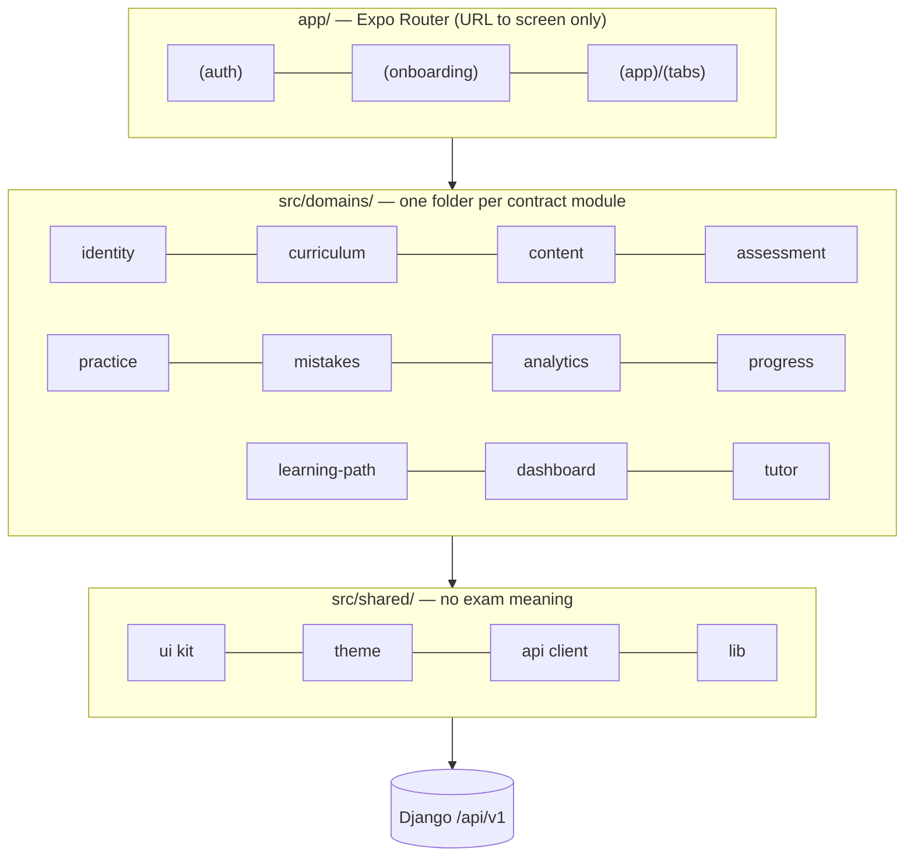
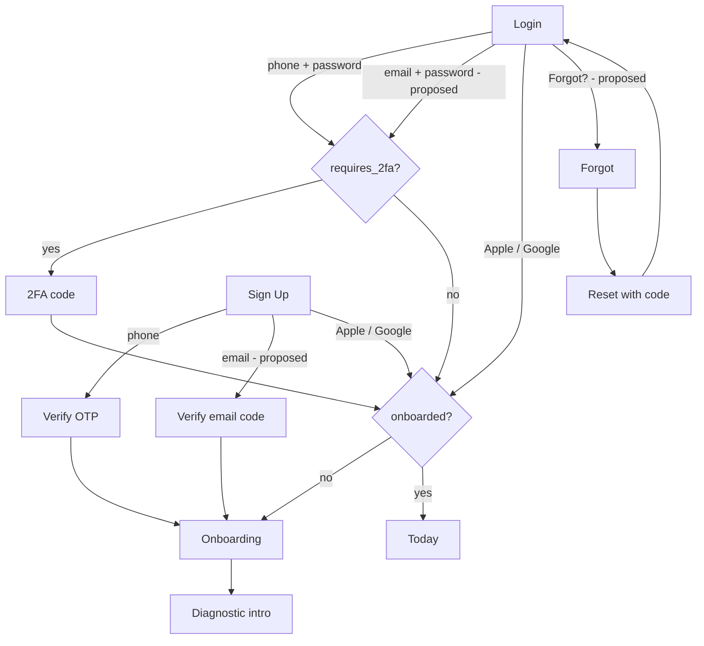
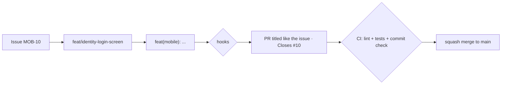

# TemariHub Mobile — Implementation Plan (V1)

> Selam opens TemariHub on a shared Android phone at 9pm, on patchy 3G.
> In one tap she knows what to study tonight, and why. Every decision in this plan serves that moment.

| | |
|---|---|
| App | `mobile/` in the `temarihub/` monorepo (built in a separate repo from this plan) |
| API | `API-Contrat.md` **V1.0 (final)**, base URL `/api/v1` |
| Stack | Expo (latest SDK; Expo Go in the sprint, development build in phase 2) · Expo Router · TypeScript strict · TanStack Query · Zustand · React Hook Form + Zod |
| Styling | StyleSheet + typed `tokens.ts` ([§5](#5-styling-stylesheet-for-the-sprint)) |
| Sign-in | Sprint: phone + password with OTP. Phase 2: Apple · Google · Email · forgot password · Google Authenticator 2FA |
| Builder | One developer, 6 hours a day |
| Schedule | **2-week sprint:** 12 working days = 24 blocks of 3 hours for the core loop + Insights + learning path. **Phase 2:** about 10 more days for sign-in extras and the AI tutor ([§10](#10-schedule-2-week-sprint-then-phase-2), one-page view in [`TWO_WEEK_SPRINT_PLAN.md`](./TWO_WEEK_SPRINT_PLAN.md)) |
| Backend | Live during the sprint |

**Order of authority:** the API contract decides data and endpoints, the PRD decides product intent, and Figma decides the look. Anything this plan needs that the contract doesn't have is marked **Proposed** and listed in [§8](#8-proposed-api-additions).

---

## Contents

1. [Decisions already made](#1-decisions-already-made)
2. [Open decisions](#2-open-decisions)
3. [How the app is organized](#3-how-the-app-is-organized)
4. [Folder structure](#4-folder-structure)
5. [Styling: StyleSheet for the sprint](#5-styling-stylesheet-for-the-sprint)
6. [Setup and running locally](#6-setup-and-running-locally)
7. [Sign-in: flows, screens, and the one-view rule](#7-sign-in-flows-screens-and-the-one-view-rule)
8. [Proposed API additions](#8-proposed-api-additions)
9. [Contract gaps to confirm with backend](#9-contract-gaps-to-confirm-with-backend)
10. [Schedule: 2-week sprint, then phase 2](#10-schedule-2-week-sprint-then-phase-2)
11. [GitHub issues, day by day](#11-github-issues-day-by-day)
12. [Figma vs V1 scope](#12-figma-vs-v1-scope)
13. [Git workflow and hooks](#13-git-workflow-and-hooks)
14. [Using the frontend-design skill](#14-using-the-frontend-design-skill)
15. [Checking what AI gives you](#15-checking-what-ai-gives-you)
16. [Definition of done](#16-definition-of-done)

---

## 1. Decisions already made

| Topic | Decision | Source |
|---|---|---|
| Primary identifier | Phone number in E.164 (`+251912345678`) | Contract §4 |
| Phone sign up | Register → send OTP → verify OTP → tokens | Contract §4–5 |
| 2FA | Google Authenticator (TOTP), optional, set up from Profile | Contract §7 |
| Apple sign-in | iOS (contract) **and** Android (proposed redirect) | Contract §8 + §8.4 here |
| Google sign-in (OAuth) | Required. Proposed endpoint | §8.2 here |
| Email sign up / login | Required. Proposed endpoints; codes sent by Resend | §8.3 here |
| Forgot password | Proposed, reuses OTP (SMS) or an email code | §8.5 here |
| AI tutor | Full chat (`/rag/chat`) with history, **and** "Explain this" on a wrong answer opens a chat about that question | Contract §35–38 |
| Mastery bands | `needs_attention` 0–39 · `developing` 40–59 · `proficient` 60–79 · `strong` 80–100 | Contract §22.4 |
| Diagnostic | 100 questions, sectioned by subject | Contract §15 |
| Exam Track picker | Moves from Sign Up to Onboarding | `POST /auth/onboarding` |
| Login / Sign Up layout | Google + Apple icon row, then **Phone \| Email** toggle above one form. Phone is the default. | |
| One-view rule | Auth screens never scroll at rest; the layout adapts to phone height | |
| Contract gaps | Listed in §9; G1–G3 answered on sprint Day 1, the rest use mocks until confirmed | |
| Schedule | 12-day sprint (phase 1), then about 10 days of phase 2 | §10 |
| Sprint scope | Phone auth, onboarding, profile, curriculum, diagnostic, practice, mistakes, progress, Insights, learning path, Today | §10.2 |
| Sprint runtime | Expo Go; development build is phase 2 Day 1 | §6.1 |
| Social and email UI in the sprint | Built behind `FEATURE_SOCIAL_AUTH` / `FEATURE_EMAIL_AUTH` (off); height budget tested with them on | §10.2 |
| 2FA during the sprint | If login returns `requires_2fa`, show "Two-step sign-in is coming soon" and stop | MOB-11 |
| Hooks | Plain shell in `.githooks/`, based on your A2SV sample, relaxed | |
| Commit tracks | `web \| mobile \| backend \| ci \| api` | Your sample |

---

## 2. Open decisions

| # | Question | Needed by | Default if undecided |
|---|---|---|---|
| 1 | SMS provider for OTP? (Resend sends email only) | Day 3B | Backend detail; a real SMS must arrive by Day 3 |
| 2 | Account linking: phone account and a Google/Apple/email login with the same person. Link or error? | P2-4 | Show "This account already exists. Log in with your phone." |
| 3 | Must email sign-ups verify before onboarding? | P2-5 | Yes |
| 4 | Keep "Remember me" from Figma? Refresh rotation keeps students logged in anyway. | Day 2B | Remove it |
| 5 | Terms on small phones: checkbox or one line of text under the button? | Day 3A | Text on compact, checkbox on tall |
| 6 | Bottom tabs. Five fit comfortably. | Day 4A | Today · Learn · Practice · Tutor · Me (Mistakes and Insights open from Today and Me; Tutor tab hidden until phase 2) |
| 7 | Ethiopian numbers only (`+251 9…`, `+251 7…`) or international? | Day 2B | Ethiopian only, fixed +251 prefix |
| 8 | Do Apple/Google/email users have to add a phone number later? | P2-3 | No, optional in Profile |

Settled by the sprint: sessions per week (6 h/day × 12 days) and styling (StyleSheet).

---

## 3. How the app is organized

Mobile domains follow the contract's modules, so "analytics" means the same thing in Django, the API, and the app.



| Mobile domain | Contract modules |
|---|---|
| `identity` | `/auth` (+ proposed Google, email, reset, Apple Android) |
| `curriculum` | `/curriculum` |
| `content` | `/questions` (student-facing reads only) |
| `assessment` | `/diagnostic` |
| `practice` | `/practice` |
| `mistakes` | `/mistakes` |
| `analytics` | `/analytics`, `/mastery` |
| `progress` | `/progress` |
| `learning-path` | `/learning-path`, `/recommendations` |
| `dashboard` | `/dashboard` |
| `tutor` | `/rag/chat`, `/rag/conversations` |

Admin-only endpoints (`POST /questions`, `/rag/resources*`, `/rag/search`) are not used by the mobile app.

---

## 4. Folder structure

```text
mobile/
├── app/                                   # Expo Router. Route files only map a URL to a screen.
│   ├── _layout.tsx                        # Providers: QueryClient, fonts, safe area, session gate
│   ├── index.tsx                          # Redirect: login / verify / 2fa / onboarding / today
│   ├── (auth)/
│   │   ├── login.tsx
│   │   ├── signup.tsx
│   │   ├── verify.tsx                     # 6-digit OTP (SMS) or email code
│   │   ├── two-factor.tsx                 # Google Authenticator code at login
│   │   ├── forgot-password.tsx
│   │   └── reset-password.tsx
│   ├── (onboarding)/index.tsx             # Grade + stream
│   └── (app)/
│       ├── _layout.tsx                    # Requires session + onboarded
│       ├── (tabs)/                        # Today · Learn · Practice · Tutor · Me (open decision #6)
│       │   ├── today.tsx
│       │   ├── learn.tsx
│       │   ├── practice.tsx
│       │   ├── tutor.tsx                  # Conversation list
│       │   └── me.tsx
│       ├── subject/[subjectId].tsx
│       ├── topic/[topicId].tsx
│       ├── diagnostic/index.tsx · [testId].tsx · results/[testId].tsx
│       ├── session/[sessionId].tsx        # Practice runner
│       ├── mistakes/index.tsx
│       ├── insights/index.tsx · subject/[subjectId].tsx · topic/[topicId].tsx
│       ├── path/index.tsx                 # Learning path
│       ├── tutor/[conversationId].tsx     # Chat thread ("new" for a fresh one)
│       └── security/two-factor.tsx        # 2FA setup / disable
│
├── src/
│   ├── domains/
│   │   ├── identity/
│   │   │   ├── api.ts                     # register, login, sendOtp, verifyOtp, twoFactor*, apple,
│   │   │   │                              # google*, email*, forgot*, refresh, logout, me, onboarding
│   │   │   ├── types.ts                   # Re-exports generated types
│   │   │   ├── schemas.ts                 # Zod: E.164 phone, email, password, 6-digit code
│   │   │   ├── session.store.ts           # Zustand + SecureStore; handles refresh rotation
│   │   │   ├── providers/
│   │   │   │   ├── apple.ios.ts           # Native Apple → identity_token + authorization_code
│   │   │   │   ├── apple.android.ts       # Web flow → proposed callback → deep link
│   │   │   │   ├── google.ts              # Native Google → id_token (proposed endpoint)
│   │   │   │   └── authenticator.ts       # Opens otpauth:// in an authenticator app
│   │   │   ├── hooks/                     # useLogin, useRegister, useOtp, useTwoFactor,
│   │   │   │                              # useSocialSignIn, usePasswordReset, useMe, useOnboarding
│   │   │   ├── components/                # AuthHeader, SocialRow, MethodToggle, PhoneField,
│   │   │   │                              # PasswordField, CodeInput, TrackPicker
│   │   │   ├── screens/                   # Login, Signup, Verify, TwoFactorChallenge, ForgotPassword,
│   │   │   │                              # ResetPassword, Onboarding, Profile, TwoFactorSetup
│   │   │   ├── __tests__/
│   │   │   └── index.ts                   # The only file other code may import from
│   │   ├── curriculum/                    # Subjects → units → topics, topic page, search
│   │   ├── content/                       # QuestionCard, ChoiceButton, SourceBadge, useQuestion(id)
│   │   ├── assessment/                    # Diagnostic intro, runner (100 q, resumable), results
│   │   ├── practice/                      # Session setup, runner, answer feedback, retry, summary
│   │   ├── mistakes/                      # Notebook list, repeat-mistake marker, practice mistakes
│   │   ├── analytics/                     # Insights: overall, subjects, topics, concepts; MasteryBand, TrendTag
│   │   ├── progress/                      # Summary + learning streak
│   │   ├── learning-path/                 # Path groups, locked reasons, next action, recommendations
│   │   ├── dashboard/                     # Today screen (reads only)
│   │   └── tutor/                         # Chat thread, sources sheet, conversation list, Explain entry
│   │       # every domain uses the same inner layout as identity/
│   │
│   ├── shared/
│   │   ├── theme/tokens.ts · fonts.ts
│   │   ├── ui/                            # Screen, Text, Button, IconButton, TextField, SegmentedToggle,
│   │   │                                  # Checkbox, Badge, Card, Sheet, Skeleton, EmptyState,
│   │   │                                  # ErrorState, OfflineBanner
│   │   ├── api/
│   │   │   ├── client.ts                  # Base URL, Bearer header, refresh-and-retry once on 401
│   │   │   ├── errors.ts                  # ApiError { code, message } (contract §3.7)
│   │   │   ├── pagination.ts              # { items, page, page_size, total } helpers
│   │   │   ├── queryClient.ts
│   │   │   ├── schema.d.ts                # Generated by openapi-typescript. Never edit.
│   │   │   └── mocks/                     # Contract examples + §8 proposals + §9 assumptions
│   │   ├── hooks/                         # useCompactLayout, useKeyboardVisible, useNetworkStatus
│   │   └── lib/                           # analytics events, secureStorage, format (%, minutes, phone)
│   └── config/env.ts
│
├── assets/ fonts/ · icons/ · images/
├── e2e/                                   # Maestro flows
├── app.json · eas.json · tsconfig.json · package.json
```

### Rules that keep it clean

1. **Import other domains only through their `index.ts`** (ESLint `no-restricted-imports`).
2. **Only `dashboard` and `learning-path` may depend on many domains.**
3. **Server data lives in TanStack Query.** Zustand holds only the session.
4. **Mobile never calculates mastery, trends, or strongest/weakest subjects.** It displays what `/analytics`, `/mastery`, and `/dashboard` return (contract §44, §46).
5. **Every number on screen comes from the API.**
6. **No raw hex or magic numbers in screens.** Tokens only.
7. **Every screen has loading, empty, error, and data states.**
8. **Build on mocks first** (`EXPO_PUBLIC_USE_MOCKS=true`).
9. **Tokens, OTPs, TOTP secrets, and passwords never reach logs, analytics, or AsyncStorage.** Refresh tokens live in SecureStore. Rotation means the new refresh token replaces the old one immediately.

---

## 5. Styling: StyleSheet for the sprint

**Decided:** StyleSheet + a typed `tokens.ts`. With no buffer in the sprint, a styling setup that can break after an Expo upgrade isn't worth the risk. Record it on Day 1 in `docs/adr/0001-styling.md`. NativeWind can be reconsidered after phase 2; because every screen reads from `tokens.ts`, switching later only touches `shared/ui`.

How the two compared:

| | NativeWind | StyleSheet + typed theme |
|---|---|---|
| Matches PRD | Yes | No (allowed to change) |
| Shared with Next.js web | Same Tailwind classes and tokens | Tokens only |
| Setup | Babel/Metro config, sensitive to Expo SDK upgrades | None |
| Mistakes | Wrong class silently does nothing | TypeScript catches a wrong key |
| Low-end Android | Good | Best |
| Figma output (Tailwind) | Close to it | Needs translating |
| Sprint risk | Lost blocks if setup breaks after an upgrade | Low |

`tokens.ts` is the single source of truth: no raw hex or font sizes in screens.

---

## 6. Setup and running locally

### 6.1 Expo Go in the sprint, development build in phase 2

Everything in the sprint runs in **Expo Go**, so there's no native build to set up. SMS code autofill uses the keyboard's one-time-code suggestion (`textContentType="oneTimeCode"`, `autoComplete="sms-otp"`), which works in Expo Go.

Native Apple and Google sign-in need modules Expo Go doesn't include. On **phase 2 Day 1** (MOB-03) the app moves to an **Expo development build**: your own debug app, built once, then live-reloaded like Expo Go.

### 6.2 Create the app

```bash
npx create-expo-app@latest mobile
cd mobile
# Sprint (Day 1)
npx expo install expo-secure-store expo-font @expo-google-fonts/inter \
  react-native-svg react-native-reanimated react-native-safe-area-context \
  @react-native-community/netinfo expo-linking
npm i @tanstack/react-query zustand react-hook-form zod @hookform/resolvers libphonenumber-js
npm i -D openapi-typescript jest-expo @testing-library/react-native eslint prettier

# Phase 2 (Day 1)
npx expo install expo-dev-client expo-apple-authentication expo-auth-session \
  expo-web-browser expo-crypto expo-clipboard
npm i @react-native-google-signin/google-signin
```

### 6.3 Accounts and keys (request on sprint Day 1, needed by phase 2 Day 3)

| Item | Where | Notes |
|---|---|---|
| Apple Sign In + Services ID | Apple Developer (paid) | Services ID and return URL are needed for Android |
| Google OAuth client IDs | Google Cloud Console | Android, iOS, and web (backend verifies against web) |
| Bundle / package ID | `app.json` | Confirm the real ID, e.g. `com.temarihub.app` |
| SMS provider, Resend, OpenAI keys | Backend only | Never in the app |

### 6.4 Environment

```bash
# mobile/.env (gitignored; commit .env.example)
EXPO_PUBLIC_API_URL=http://192.168.1.20:8000/api/v1
EXPO_PUBLIC_USE_MOCKS=false            # backend is live; true only for phase 2 proposals not yet built
EXPO_PUBLIC_FEATURE_SOCIAL_AUTH=false  # Google + Apple row; on in phase 2
EXPO_PUBLIC_FEATURE_EMAIL_AUTH=false   # Phone | Email toggle; on in phase 2
EXPO_PUBLIC_GOOGLE_WEB_CLIENT_ID=...   # phase 2
EXPO_PUBLIC_GOOGLE_IOS_CLIENT_ID=...   # phase 2
```

`EXPO_PUBLIC_*` ships inside the app, so only public IDs go here.

### 6.5 Run it

```bash
# Sprint
npx expo start                  # scan the QR code with Expo Go
npx openapi-typescript http://localhost:8000/api/schema/ -o src/shared/api/schema.d.ts
eas build --profile preview --platform android   # Day 12: APK link for testers

# Phase 2
npx expo run:android            # first time: builds and installs the dev build
eas build --profile development --platform ios   # iOS without a Mac
npx expo start --dev-client     # day to day
```

Default test device: **360 × 640 dp Android emulator**. If it fits there, it fits the phones students actually have.

---

## 7. Sign-in: flows, screens, and the one-view rule

### 7.1 Every path into the app



Contract-backed paths: phone sign up, phone login, 2FA, Apple on iOS, refresh, logout, onboarding. Everything marked "proposed" waits on §8.

### 7.2 The one-view rule

> At rest, with the keyboard closed, every auth screen shows everything including the main button and the switch link. Nothing scrolls. The layout adapts to the phone's height.

| Size | Height (dp) | Shows |
|---|---|---|
| Compact | under 700 | Logo row, one-line heading, social row, toggle, fields, button, switch link |
| Regular | 700–779 | + badge and one-line subtitle |
| Roomy | 780+ | + two-line Figma heading and feature card |

When the keyboard opens, scrolling unlocks so the focused field and the button stay reachable. It locks again when the keyboard closes.

```tsx
// Illustrative shape, not final code
<ScrollView
  scrollEnabled={keyboardOpen}
  contentContainerStyle={{ flexGrow: 1, justifyContent: 'space-between' }}
>
  <Top /> <Form /> <Bottom />
</ScrollView>
```

### 7.3 Login (Figma `22:1635`, adapted)

```text
┌──────────────────────────────┐
│ ‹  [cap] TemariHub           │
│ GRADE 12 PREP                │  regular+
│ Master your next mock.       │
│  [ G ]          [  ]        │  Google + Apple, 52 dp
│ ───────── or ─────────       │
│ [  Phone  |  Email  ]        │  Phone is default
│ Phone number                 │
│ [ +251 | 91 234 5678      ]  │
│ Password             Forgot? │
│ [ 🔒 ••••••••        Show ]  │
│ [   Log In to TemariHub  → ] │
│ New here? Create free account│
│ ┌ feature card ────────────┐ │  roomy only
└──────────────────────────────┘
```

Compact height budget: about **530 dp** of about 600 usable.

### 7.4 Sign Up (Figma `22:1740`, adapted)

Social row, toggle, then **Full name → Phone (or Email) → Password (min-8 hint)**, button, terms (decision #5), and "Have an account? Log in". On compact, "Log in" moves to the header's top-right. Estimate: **about 590 dp**. This is the tightest screen, so test it first.

### 7.5 Verify OTP (no Figma frame yet)

- "We sent a 6-digit code to +251 91 234 5678"
- Six boxes with SMS autofill (`autoComplete="sms-otp"`, `textContentType="oneTimeCode"`)
- Countdown from `expires_in` (300 s), then "Send a new code" (`POST /auth/phone/send-otp`)
- "Wrong number? Change it"
- On success, `verify-otp` returns tokens and `user` → straight to Onboarding

### 7.6 2FA with Google Authenticator

**At login:** if `/auth/login` returns `requires_2fa: true`, keep `two_factor_token` in memory only and show the 2FA screen. `POST /auth/2fa/login` returns tokens.

**Setup from Profile → Security:**
1. `POST /auth/2fa/setup` returns `secret`, `otpauth_url`, `qr_code`.
2. The student is usually on the same phone as the authenticator, so a QR code alone doesn't work. Show three options:
   - **"Open in authenticator app"** (opens `otpauth_url`)
   - **"Copy setup key"** (copies `secret`, auto-clears after 60 s)
   - The QR code, for scanning from a second device
3. She types the current 6-digit code → `POST /auth/2fa/verify` → `enabled: true`.

**Disable:** password + current code → `POST /auth/2fa/disable`.

The secret is never logged or stored. Consider blocking screenshots on that screen.

### 7.7 Proving it

```yaml
# e2e/auth-one-view.yaml — run on 360x640, then on a tall phone
appId: com.temarihub.app
---
- launchApp
- assertVisible: "Log In to TemariHub"
- assertVisible: "Create free account"
- tapOn: "Email"
- assertVisible: "Log In to TemariHub"
- tapOn: "Create free account"
- assertVisible: "Create My Account"
```

---

## 8. Proposed API additions

> **Status: Proposed, needs backend approval** before it goes into the contract. Shapes reuse the final contract's naming and response formats. Mobile builds on mocks until approved.

### 8.1 Shared response shape

Every new sign-in endpoint returns the same shape as `POST /auth/apple`, so mobile has one handler:

```json
{ "access_token": "...", "refresh_token": "...", "token_type": "Bearer",
  "user": { "id": "uuid", "full_name": "...", "onboarded": false } }
```

Password-based logins return the same shape as `POST /auth/login`, including `requires_2fa` and `two_factor_token`.

### 8.2 Google sign-in

```text
POST /auth/google      { "id_token": "google-id-token" }      → shared shape (§8.1)
Errors: 401 GOOGLE_TOKEN_INVALID · 409 ACCOUNT_EXISTS_OTHER_METHOD
```

### 8.3 Email sign up and login (codes sent with Resend)

```text
POST /auth/email/register     { email, password, full_name }   → { id, email, full_name, email_verified: false, onboarded: false }
POST /auth/email/send-code    { email }                        → { message, expires_in }
POST /auth/email/verify-code  { email, code }                  → shared shape (§8.1)
POST /auth/email/login        { email, password }              → same as POST /auth/login
Errors: 409 EMAIL_TAKEN · 400 INVALID_EMAIL · 400 WEAK_PASSWORD · 403 EMAIL_NOT_VERIFIED
```

### 8.4 Apple on Android

```text
POST /auth/apple/callback    Apple posts here (web flow), backend redirects to:
                             temarihub://auth/apple?identity_token=...&authorization_code=...
                             then the app calls the existing POST /auth/apple
```

### 8.5 Forgot password (reuses OTP)

```text
POST /auth/password/forgot   { phone_number } or { email }               → 202 always (never reveals if an account exists)
POST /auth/password/reset    { phone_number | email, otp, new_password } → 200
Errors: 400 INVALID_OTP · 410 OTP_EXPIRED · 429 TOO_MANY_ATTEMPTS · 400 WEAK_PASSWORD
```

### 8.6 Changes to existing responses

| Endpoint | Addition |
|---|---|
| `GET /auth/me` | `email`, `email_verified`, `auth_providers: ["phone", "apple", "google", "email"]` |
| `POST /auth/apple` | Optional `full_name` in the request (Apple only shares the name on the first sign-in) |

---

## 9. Contract gaps to confirm with backend

Mobile builds each of these on mocks using the "mobile assumes" column, and switches to the real shape once confirmed.

| # | Gap | Why mobile needs it | Mobile assumes until confirmed |
|---|---|---|---|
| G1 | `POST /diagnostic/start` returns `question_count` per section but no question IDs or `subject_name` | Can't fetch or label the questions | Sections also include `subject_name` and `question_ids`; each fetched via `GET /questions/{id}` |
| G2 | `POST /practice/sessions` has no response shape | Can't start the runner | `{ session_id, question_ids }` |
| G3 | `GET /mistakes/me` items have IDs and counts only, no prompt, choices, or explanation | Notebook can't show the question | Fetch each via `GET /questions/{id}`; ask backend to embed `prompt`, `your_choice`, `correct_choice`, `explanation` |
| G4 | `POST /diagnostic/{id}/answer` has no response | | `200 { recorded: true }` |
| G5 | `POST /diagnostic/{id}/complete`: `subjects`, `strong_topics`, `weak_topics` item shapes are empty | Results screen layout | `subjects: [{ subject_id, subject_name, score_pct }]`, topics `[{ topic_id, topic_name, mastery_score }]` |
| G6 | `GET /dashboard/me` objects are `{}` / `[]` | Today screen | Same item shapes as `/analytics/me` and `/learning-path/me/next` |
| G7 | `GET /learning-path/me` lists (`recommended`, `locked`…) item shape | Path screen | Learning Path Item from contract §28 |
| G8 | Who calls `POST /learning-path/me/recalculate`? | Avoid double or missing recalculation | Backend runs it after diagnostic/practice complete; mobile only refetches. Mobile never calls it unless confirmed. |
| G9 | `/learning-path/me/next` vs `/recommendations/me` vs `dashboard.recommended_next` | Which one drives "Study next"? | Dashboard uses `recommended_next`; path screen uses `/next`; "Why this?" sheet uses `/recommendations/me` signals |
| G10 | `POST /rag/chat`: first message without `conversation_id`? Streaming or one response? Typical latency? | Chat UX | `conversation_id` optional on first message; one JSON response; up to ~10 s |
| G11 | `/rag/chat` rate-limit and "no grounded answer" responses | Honest error states (PRD) | `429 RATE_LIMITED` with `retry_after_seconds`; `sources: []` plus a message means "not available yet" |
| G12 | `GET /rag/conversations` item shape | List screen | `{ conversation_id, title, topic_name, updated_at }`, paginated |
| G13 | Does `POST /auth/register` send the OTP automatically? | Avoid a duplicate SMS | Mobile calls `send-otp` right after `register` |
| G14 | OTP and 2FA error codes | Clear messages | `INVALID_OTP`, `OTP_EXPIRED`, `TOO_MANY_ATTEMPTS`, `INVALID_2FA_CODE`, `2FA_TOKEN_EXPIRED` |
| G15 | Question `source` is free text (`"Entrance Exam"`) and `exam_year` is a number | Source badge | Show `source` as given, plus `exam_year` when present |
| G16 | Mastery bands: `/analytics` returns `mastery_band`; does `/mastery` too? | One band component | Mobile reads `mastery_band` when present, else derives it from score using §22.4 thresholds from config |
| G17 | `/progress/me/subjects/{id}` has no response shape | | Reuse the subject item from `/analytics/me/subjects` |
| G18 | `POST /auth/logout` response | | `204 No Content` |

---

## 10. Schedule: 2-week sprint, then phase 2

The one-page version of this schedule is in [`TWO_WEEK_SPRINT_PLAN.md`](./TWO_WEEK_SPRINT_PLAN.md). The two files say the same thing.

### 10.1 The budget

| | |
|---|---|
| Builder | One developer |
| Sprint | 12 working days × 6 hours = 72 hours = **24 blocks of 3 hours** (morning block A, afternoon block B) |
| Phase 2 | About 10 more working days at the same pace |
| Backend | Live during the sprint (contract V1.0) |
| Buffer | **None.** Use the cut list in §10.5 the same day a block runs over |

A **block** is 3 focused hours that end with something running on your phone and a pushed branch.

### 10.2 What ships when

| Sprint (phase 1) | Phase 2 |
|---|---|
| Phone sign up → SMS code → onboarding | Google sign-in (§8.2) |
| Phone login, logout, stay signed in | Apple sign-in on iOS and Android |
| Profile + change password | Email sign up / login (§8.3) |
| Curriculum browse + topic detail | Forgot / reset password (§8.5) |
| Diagnostic (100 questions, resumable) + results | Google Authenticator 2FA |
| Practice: feedback, retry, summary, offline-safe answers | AI tutor chat + "Explain this" |
| Mistake notebook + practice my mistakes | Curriculum search |
| Progress, Insights (overall, subjects, topics, concepts) | Analytics events |
| Learning path, next action, "Why this?" | Development build |
| Today dashboard | |
| Accessibility + low-end Android pass, preview build | |

Everything in the sprint is already in the final contract, so nothing waits on §8 approval. Login and Sign Up are built with the social row and the Phone | Email toggle behind flags (`FEATURE_SOCIAL_AUTH`, `FEATURE_EMAIL_AUTH`, both off), and the one-view height budget is tested with them **on**, so phase 2 doesn't break the layout.

### 10.3 Day 1 prerequisites

| # | What | Why it can't wait |
|---|---|---|
| 1 | Backend answers gaps **G1, G2, G3** (§9) | Days 6–8 depend on them |
| 2 | Styling is **StyleSheet + `tokens.ts`** (§5) | No spike; saves a block |
| 3 | **Expo Go** for the sprint; development build in phase 2 | Saves a block and native setup |
| 4 | Request Apple and Google developer accounts, and send §8 to backend | Phase 2 days 3–5 need them |

### 10.4 Day by day

```mermaid
gantt
    title Sprint (12 working days)
    dateFormat  X
    axisFormat  D%s
    section Foundation
    Setup, tokens, api client             :0, 2
    section Identity
    Login, sign up, verify, session, onboarding :2, 4
    section Learning loop
    Curriculum, question card             :4, 5
    Diagnostic                            :5, 6
    Practice                              :6, 7
    Mistakes, progress, insights          :7, 8
    section Understanding
    Analytics, learning path              :8, 9
    Next action, Today                    :9, 10
    section Ship
    Tests, polish                         :10, 11
    QA, preview build                     :11, 12
```



#### Sprint week 1

| Day | Block | Build | Done when | Issues |
|---|---|---|---|---|
| **1** | A | Scaffold, TS strict, folder structure, ESLint domain rule, Prettier, hooks; send gap questions and §8 to backend | App runs in Expo Go; a bad commit is rejected | MOB-01, 02 |
| | B | `tokens.ts` from Figma, Inter fonts, `shared/ui` primitives | Kitchen-sink screen shows every primitive | MOB-04 |
| **2** | A | API client (error shape, pagination, refresh rotation), QueryClient; Skeleton, Empty, Error, Offline | `GET /auth/me` returns 401 cleanly; airplane mode shows the banner | MOB-05, 06 |
| | B | **Login**: one-view layout + phone login, `requires_2fa` handled defensively | Fits 360×640; wrong password shows the contract message | MOB-10, 11 |
| **3** | A | **Sign Up**: one-view layout + `register` → `send-otp`, inline errors | `PHONE_TAKEN` under the field with "Log in instead" | MOB-12, 13 |
| | B | **Verify OTP**: six boxes, SMS autofill, countdown, resend, error states | A real SMS code logs her in | MOB-14 |
| **4** | A | Session store, SecureStore, rotation, logout; route guards + tab shell | Relaunch keeps her logged in; each state lands on the right screen | MOB-15, 17 |
| | B | **Onboarding** + **Profile** (name, grade/stream, change password, log out) | `onboarded: true`; password change works | MOB-16, 25 |
| **5** | A | Subjects → units → topics + **topic detail** | Natural Science subjects load; prerequisites tappable | MOB-30, 32 |
| | B | QuestionCard, ChoiceButton, SourceBadge, `useQuestion(id)` | Reused everywhere; `is_correct` not in the type | MOB-31 |
| **6** | A | **Diagnostic** intro + runner | "Chemistry · 12 of 25"; no right/wrong while answering | MOB-40 |
| | B | Resume, section breaks, **results** | Close mid-test → same question; weak topics link to topics | MOB-41, 42 |

#### Sprint week 2

| Day | Block | Build | Done when | Issues |
|---|---|---|---|---|
| **7** | A | **Practice** setup + runner + feedback (`mistake_recorded`) | Instant result with icon, color, explanation | MOB-50, 51 |
| | B | Retry + summary; in-flight answer survives a network drop | Sends once on reconnect | MOB-52, 53 |
| **8** | A | **Mistake notebook** + filters + repeat markers + practice my mistakes | Wrong answers appear automatically | MOB-60, 61 |
| | B | Progress + streak; MasteryBand + TrendTag; **Insights overview** | Four labeled bands; nothing calculated on the phone | MOB-70, 71 |
| **9** | A | Subject analytics + topic and concept drill-down | Weakest concept has a "Practice" action | MOB-72, 73 |
| | B | **Learning path** + locked prerequisites | Locked topic says what to do first | MOB-80, 81 |
| **10** | A | Next action + "Why this?" + refetch after sessions | Path changes after a practice session | MOB-82, 83 |
| | B | **Today dashboard** + pre-diagnostic state | One tap to "what to study tonight" | MOB-90 |
| **11** | A | Maestro one-view auth tests + Journey A | Both pass | MOB-27, 43 |
| | B | Accessibility + frontend-design polish + low-end Android check | §14.4 ticked; 130% font doesn't clip | MOB-92, 93 |
| **12** | A | Real-device QA: Journeys A, B, C, F on Android + iOS, slow network | All four pass | MOB-54, 111 |
| | B | EAS preview build, icon, splash; tag `mobile-v0.1.0-sprint` | Testers install from a link | MOB-110 |

**Journeys:** A first-time student · B daily practice · C mistakes · D browse curriculum · E tutor · F insights and path.

#### Phase 2

| Day | Build | Issues |
|---|---|---|
| 1 | Development build + EAS profiles; flags on for the social row | MOB-03 |
| 2 | 2FA at login + setup/disable | MOB-18, 19 |
| 3 | Apple on iOS + Android | MOB-20, 21 |
| 4 | Google sign-in + account-exists and cancel handling | MOB-22, 26 |
| 5 | Email sign up/login + forgot/reset password | MOB-23, 24 |
| 6–7 | AI tutor chat, sources, conversation list | MOB-100, 101 |
| 8 | "Explain this" + honest tutor states | MOB-102, 103 |
| 9 | Search, analytics events, auth device QA | MOB-33, 91, 28 |
| 10 | Release candidate `mobile-v1.0.0-rc1` | MOB-112 |

### 10.5 If you fall behind

Cut from the top first, on the same day.

| Order | Cut | Saves | Cost |
|---|---|---|---|
| 1 | Concept drill-down (part of MOB-73) | ½ block | Insights stops at topic level |
| 2 | "Why this?" sheet (part of MOB-82) | ½ block | Reason line only |
| 3 | Maestro Journey A (MOB-43) | ½ block | Tested by hand on Day 12 |
| 4 | Subject analytics list (MOB-72) | ½ block | Overview links straight to topics |
| 5 | Diagnostic section breaks (part of MOB-41) | ½ block | Resume still works |
| 6 | Profile editing (part of MOB-25) | ½ block | Info, log out, change password only |

**Never cut:** one-view auth, session security, diagnostic resume, the in-flight answer fix, honest empty/error states, or "no numbers calculated on the phone".

**Daily check (5 minutes):** is today's "Done when" true on a real phone? If not, pick a cut now and write it in the issue.

---

## 11. GitHub issues, day by day

### 11.1 How to read this

- Issues are grouped by the **sprint day and block** they're built in (for example `Day 2B`), then by **phase 2 day** (`P2-3`).
- Every issue has: `domain:<name>` · `type:<feature|fix|chore|docs|test|perf>` · `platform:mobile` · `priority:p0|p1|p2` · milestone. Sprint issues also get `sprint:1`.
- **Issue title = PR title = squash commit**, so every title passes the commit hook (§13).
- `blocked-by:backend` marks issues that need a §8 proposal or a §9 gap confirmed. In the sprint, only gaps G1–G3 matter, and they're settled on Day 1.

### 11.2 Milestones

| Milestone | Issues |
|---|---|
| **Sprint · Week 1** (Days 1–6) | MOB-01, 02, 04, 05, 06, 10, 11, 12, 13, 14, 15, 16, 17, 25, 30, 31, 32, 40, 41, 42 |
| **Sprint · Week 2** (Days 7–12) | MOB-27, 43, 50, 51, 52, 53, 54, 60, 61, 70, 71, 72, 73, 80, 81, 82, 83, 90, 92, 93, 110, 111 |
| **Phase 2** | MOB-03, 18, 19, 20, 21, 22, 23, 24, 26, 28, 33, 91, 100, 101, 102, 103, 112 |

### 11.3 Issue template

```markdown
### Why
One or two sentences from Selam's point of view.

### Done when
- [ ] Observable outcome

### API
Endpoints used (contract section) · any §8 / §9 dependency

### Design
Figma node

### Not in this issue
```

---

### Sprint · Week 1 (Days 1–6)

#### Day 1 · Setup and tokens

**MOB-01 · `chore(mobile): scaffold expo app with router and strict ts`** · Day 1A · `domain:shared` · p0
Why: one clean starting point, so the first feature PR isn't also a setup PR.
- [ ] Folder structure from §4 with empty domain `index.ts` files
- [ ] TS strict, `@/` alias, ESLint domain rule, Prettier, hooks installed
- [ ] StyleSheet + `tokens.ts` recorded in `docs/adr/0001-styling.md`

**MOB-02 · `docs(api): propose google email reset and apple android auth`** · Day 1A · `domain:identity` · p0
Why: mobile and backend need to agree on shapes before sign-in is built on both sides.
- [ ] §8 opened as a PR against the API contract, marked Proposed
- [ ] §9 gaps posted as one comment/checklist for backend

**MOB-04 · `feat(mobile): add design tokens and ui primitives from figma`** · Day 1B · `domain:shared` · p0
Why: one file for colors and sizes turns a Figma update into a one-line change.
- [ ] Colors, spacing, 3 radii, 5 text sizes from the Log In frame
- [ ] Screen, Text, Button, IconButton, TextField, SegmentedToggle, Checkbox, Badge, Card, Sheet

---

#### Day 2 · API client and Login

**MOB-05 · `feat(mobile): add api client with refresh rotation and mocks`** · Day 2A · `domain:shared` · p0
Why: every screen talks to the API the same way, and mobile never waits for backend.
- [ ] Contract error shape and pagination; 401 → one refresh → retry, else logout
- [ ] Rotated refresh token replaces the old one immediately
- [ ] Mocks for the contract, §8 proposals, and §9 assumptions

**MOB-06 · `feat(mobile): add loading empty error and offline states`** · Day 2A · `domain:shared` · p1
Why: on 3G something is always loading; a frozen screen looks broken.
- [ ] Skeleton, EmptyState (one action), ErrorState (retry), OfflineBanner

**MOB-10 · `feat(mobile): build login screen that fits one view`** · Day 2B · `domain:identity` · p0
Why: Selam should see the Log In button the moment the screen opens, on any phone.
- [ ] Google + Apple row, Phone | Email toggle (Phone default), one form
- [ ] No scrolling on 360×640 or a tall phone, in both modes
- Design: Figma `22:1635`
- [ ] Sprint: social row and Phone | Email toggle built behind flags (off); height budget tested with flags on

**MOB-11 · `feat(mobile): log in with phone and password`** · Day 2B · `domain:identity` · p0
- [ ] Number normalised to E.164 before sending
- [ ] `requires_2fa: true` → 2FA screen (MOB-18); otherwise onboarded check
- [ ] Spinner + double-tap protection; contract error messages
- API: `POST /auth/login` (§6)
- [ ] Sprint: if `requires_2fa` is true, show "Two-step sign-in is coming soon" and stop (2FA setup is phase 2)

---

#### Day 3 · Sign Up and SMS code

**MOB-12 · `feat(mobile): build sign up screen that fits one view`** · Day 3A · `domain:identity` · p0
Why: sign up is the first impression. It should feel short because it is short.
- [ ] Full name, phone (or email), password with a min-8 hint, terms
- [ ] No scrolling on 360×640
- Design: Figma `22:1740` (Exam Track moves to onboarding)
- [ ] Sprint: social row and Phone | Email toggle built behind flags (off); height budget tested with flags on

**MOB-13 · `feat(mobile): register with phone number`** · Day 3A · `domain:identity` · p0
- [ ] `register` then `send-otp` (G13)
- [ ] `PHONE_TAKEN` with "Log in instead"; `INVALID_PHONE_NUMBER`; `WEAK_PASSWORD`
- API: `POST /auth/register`, `POST /auth/phone/send-otp`

**MOB-14 · `feat(mobile): verify phone with 6-digit sms code`** · Day 3B · `domain:identity` · p0 · `blocked-by:backend` (SMS provider)
Why: a verified number is how she gets back into her account later.
- [ ] Six boxes with SMS autofill (keyboard suggestion; works in Expo Go); countdown from `expires_in`; resend
- [ ] Wrong, expired, and too-many-attempts states (G14)
- API: `POST /auth/phone/verify-otp`

---

#### Day 4 · Session, guards, onboarding, profile

**MOB-15 · `feat(mobile): keep students signed in with secure session`** · Day 4A · `domain:identity` · p0
Why: retyping a password every evening is the fastest way to lose a student.
- [ ] SecureStore only; rotation handled; relaunch restores the session
- [ ] Logout calls `POST /auth/logout` and clears everything

**MOB-17 · `feat(mobile): guard routes and add tab shell`** · Day 4A · `domain:identity` · p0
- [ ] Logged out → Login · unverified → Verify · pending 2FA → 2FA (phase 2) · not onboarded → Onboarding · else Today
- [ ] Tabs per open decision #6; Tutor tab hidden until phase 2

**MOB-16 · `feat(mobile): add onboarding for grade and stream`** · Day 4B · `domain:identity` · p0
- [ ] Grade 12 + Natural Science; others "Soon"
- [ ] "Save & take diagnostic" → diagnostic intro
- Design: Figma `22:2068`

**MOB-25 · `feat(mobile): add profile and change password`** · Day 4B · `domain:identity` · p1
- [ ] Name, grade/stream, sign-in methods, 2FA status, change password, log out
- Design: Figma `22:2217` (no "PRO MEMBER")

---

#### Day 5 · Curriculum and question card

**MOB-30 · `feat(mobile): browse subjects units and topics`** · Day 5A · `domain:curriculum` · p0
Why: sometimes Selam just wants to go straight to Chemistry.
- [ ] Subjects → units → topics, cached; empty unit says "Topics coming soon"
- API: `/curriculum/subjects`, `/subjects/{id}/units`, `/units/{id}/topics`

**MOB-32 · `feat(mobile): show topic detail page`** · Day 5A · `domain:curriculum` · p0
- [ ] Objectives, tappable prerequisites, minutes, question count, "Practice this topic"
- Design: Figma `32:946`

**MOB-31 · `feat(mobile): add question card with source badge`** · Day 5B · `domain:content` · p0
Why: if she can't tell a real entrance exam question from practice, she stops trusting all of them.
- [ ] Badge shows `source` and `exam_year` (G15); choices at least 48 dp tall
- [ ] `useQuestion(id)`; reused by diagnostic, practice, and mistakes

---

#### Day 6 · Diagnostic

**MOB-40 · `feat(mobile): start and run the diagnostic test`** · Day 6A · `domain:assessment` · p0 · `blocked-by:backend` (G1, G4)
Why: this is how TemariHub stops guessing. It should feel calm, not like an exam hall.
- [ ] Intro: "100 questions", sections by subject
- [ ] "Chemistry · 12 of 25"; no right/wrong while answering; time per question; next question prefetched
- Design: Figma `32:858`

**MOB-41 · `feat(mobile): resume the diagnostic and pause between subjects`** · Day 6B · `domain:assessment` · p0
Why: 100 questions rarely happen in one sitting on a shared phone.
- [ ] Close mid-test → same question, earlier answers kept
- [ ] Calm break screen between subject sections

**MOB-42 · `feat(mobile): show diagnostic results with strong and weak topics`** · Day 6B · `domain:assessment` · p0 · `blocked-by:backend` (G5)
Why: a raw score says "you're bad". Strong and weak topics say "start here".
- [ ] Overall, per subject, strong/weak topics → topic pages
- Design: Figma `32:616`

---

### Sprint · Week 2 (Days 7–12)

#### Day 7 · Practice

**MOB-50 · `feat(mobile): start practice session with filters`** · Day 7A · `domain:practice` · p0 · `blocked-by:backend` (G2)
- [ ] Subject, topic, difficulty (at least one); zero matches → message + suggestion

**MOB-51 · `feat(mobile): answer practice questions with instant feedback`** · Day 7A · `domain:practice` · p0
Why: practice only teaches if feedback is immediate and explains why.
- [ ] Icon + color + explanation; "Saved to your notebook" when `mistake_recorded`
- [ ] Wrong answers show "Explain this" (wired in MOB-102)
- Design: Figma `32:327`, `32:1207`, `32:1295`

**MOB-52 · `feat(mobile): retry questions and show session summary`** · Day 7B · `domain:practice` · p1
- [ ] Summary uses `questions_answered`, `correct`, `accuracy_pct`

**MOB-53 · `fix(mobile): keep in-flight answer when network drops`** · Day 7B · `domain:practice` · p0
Why: losing an answer on a bad connection feels like being cheated.
- [ ] Retried on reconnect; never sent twice

---

#### Day 8 · Mistakes, progress, insights

**MOB-60 · `feat(mobile): list mistakes with filters and repeat markers`** · Day 8A · `domain:mistakes` · p0 · `blocked-by:backend` (G3)
- [ ] Question shown via `useQuestion`; "Repeated 3×" when `repeat_mistake`
- [ ] Empty: "No mistakes yet. Practice a topic to start your notebook."
- Design: Figma `32:431`

**MOB-61 · `feat(mobile): practice my mistakes`** · Day 8A · `domain:mistakes` · p0
- [ ] `POST /mistakes/practice` → session runner

**MOB-70 · `feat(mobile): show progress summary and learning streak`** · Day 8B · `domain:progress` · p1
- [ ] Attempted, correct, accuracy, topics completed, subjects started, streak
- [ ] MasteryBand (4 bands, always labeled) and TrendTag (arrow + word)

**MOB-71 · `feat(mobile): show insights overview from analytics`** · Day 8B · `domain:analytics` · p0
Why: "Am I even getting better?" This screen answers it with evidence, not vibes.
- [ ] Mastery, accuracy, trend, strongest and weakest subject, areas needing attention
- [ ] Nothing calculated on the phone

---

#### Day 9 · Analytics drill-down and learning path

**MOB-72 · `feat(mobile): list subject analytics weakest first`** · Day 9A · `domain:analytics` · p1

**MOB-73 · `feat(mobile): drill into topic and concept analytics`** · Day 9A · `domain:analytics` · p1
- [ ] Topic list filtered by subject; topic page shows concepts and common mistakes
- [ ] Weakest concept has a "Practice" action

**MOB-80 · `feat(mobile): show adaptive learning path`** · Day 9B · `domain:learning-path` · p0 · `blocked-by:backend` (G7)
Why: the path is the answer to "what should I study next". It must look like a plan, not a list.
- [ ] Recommended, in progress, completed, locked, skipped; reason per item in plain words

**MOB-81 · `feat(mobile): explain locked topics and their prerequisites`** · Day 9B · `domain:learning-path` · p1
- [ ] Locked item → sheet with prerequisites and a link to the first one

---

#### Day 10 · Next action and Today

**MOB-82 · `feat(mobile): show next action and why it was chosen`** · Day 10A · `domain:learning-path` · p0 · `blocked-by:backend` (G9)
- [ ] `/learning-path/me/next` card; "Why this?" uses `/recommendations/me` signals
- [ ] Reasons translated, e.g. `low_mastery_and_repeated_mistakes` → "Low mastery and 5 repeated mistakes"

**MOB-83 · `feat(mobile): refresh learning path after each session`** · Day 10A · `domain:learning-path` · p1 · `blocked-by:backend` (G8)
- [ ] Path, analytics, and dashboard queries refetch after diagnostic/practice complete

**MOB-90 · `feat(mobile): build today dashboard from live data`** · Day 10B · `domain:dashboard` · p0 · `blocked-by:backend` (G6)
Why: one tap from opening the app to knowing what to study tonight. That's the product.
- [ ] Progress, strongest/weakest, weak topics, current topic, recommended next, streak, recent activity
- [ ] Before the diagnostic: one card, "Take your diagnostic"
- Design: Figma `22:2336`

---

#### Day 11 · Tests and polish

**MOB-27 · `test(mobile): add one-view auth tests on small and tall phones`** · Day 11A · `domain:identity` · p1
- [ ] Maestro for Login, Sign Up, Verify, 2FA, Forgot, Reset in phone and email modes
- [ ] Sprint: Login, Sign Up, Verify in phone mode, with flags off and on; 2FA, Forgot, Reset and email mode are added in phase 2

**MOB-43 · `test(mobile): add journey a from sign up to diagnostic results`** · Day 11A · `domain:assessment` · p1

**MOB-92 · `perf(mobile): pass accessibility audit`** · Day 11B · `domain:shared` · p1
- [ ] Labels, 48 dp targets, 130% font scale, color never the only signal

**MOB-93 · `perf(mobile): polish ui and tune for low-end android`** · Day 11B · `domain:shared` · p1
- [ ] §14.4 checklist ticked; no live blur; smooth lists

---

#### Day 12 · QA and preview build

**MOB-54 · `test(mobile): cover practice hooks and journey b`** · Day 12A · `domain:practice` · p1

**MOB-111 · `test(mobile): run journeys a to f on two devices`** · Day 12A · `domain:shared` · p0
- [ ] Sprint: Journeys A, B, C, F only (E, the tutor, is phase 2)

**MOB-110 · `chore(mobile): ship eas preview build`** · Day 12B · `domain:shared` · p1
- [ ] Sprint: add only the `preview` profile to `eas.json` (MOB-03 adds the rest in phase 2); icon, splash, bundle ID
- [ ] Android APK link shared with testers; tag `mobile-v0.1.0-sprint`

---

### Phase 2 (after the sprint)

#### Phase 2 · Day 1 · Development build

**MOB-03 · `chore(mobile): set up development build and eas profiles`** · P2-1 · `domain:shared` · p0
Why: Apple and Google sign-in don't run in Expo Go.
- [ ] `development`, `preview`, `production` profiles; `temarihub://` scheme; bundle IDs
- [ ] Dev build installed on a real Android phone

---

#### Phase 2 · Day 2 · Google Authenticator 2FA

**MOB-18 · `feat(mobile): ask for authenticator code at login`** · P2-2 · `domain:identity` · p1
Why: students who turned on 2FA expect it to protect them every time.
- [ ] `two_factor_token` kept in memory only; `POST /auth/2fa/login`
- [ ] Wrong and expired code messages

**MOB-19 · `feat(mobile): set up and disable google authenticator`** · P2-2 · `domain:identity` · p1
Why: she's usually on the same phone as the authenticator, so a QR code alone doesn't help.
- [ ] "Open in authenticator app", "Copy setup key" (auto-clears), QR for a second device
- [ ] Verify to enable; password + code to disable
- [ ] Secret never logged or persisted
- API: `/auth/2fa/setup`, `/verify`, `/disable`

---

#### Phase 2 · Day 3 · Apple sign-in

**MOB-20 · `feat(mobile): sign in with apple on ios`** · P2-3 · `domain:identity` · p0
- [ ] Sends `identity_token` + `authorization_code`; `full_name` on the first sign-in (§8.6)
- [ ] New → Onboarding; existing → Today; cancel returns quietly
- API: `POST /auth/apple`

**MOB-21 · `feat(mobile): sign in with apple on android`** · P2-3 · `domain:identity` · p1 · `blocked-by:backend` (§8.4)
- [ ] Web flow → `temarihub://auth/apple` → `POST /auth/apple`

---

#### Phase 2 · Day 4 · Google sign-in and edge cases

**MOB-22 · `feat(mobile): sign in with google on android and ios`** · P2-4 · `domain:identity` · p0 · `blocked-by:backend` (§8.2)
Why: most students already have Gmail on their phone; one tap beats typing on a small keyboard.
- [ ] Native sign-in → `id_token` → `POST /auth/google`
- [ ] Cancel returns quietly; `GOOGLE_TOKEN_INVALID` shows a friendly message

**MOB-26 · `fix(mobile): handle existing accounts and cancelled sign-ins`** · P2-4 · `domain:identity` · p1
- [ ] `ACCOUNT_EXISTS_OTHER_METHOD` copy per open decision #2
- [ ] Cancelled Apple/Google never shows an error

---

#### Phase 2 · Day 5 · Email and password reset

**MOB-23 · `feat(mobile): sign up and log in with email`** · P2-5 · `domain:identity` · p1 · `blocked-by:backend` (§8.3)
- [ ] Email mode of the toggle works on Login and Sign Up
- [ ] Verify screen reused for the email code; `EMAIL_TAKEN` inline

**MOB-24 · `feat(mobile): reset password with sms or email code`** · P2-5 · `domain:identity` · p1 · `blocked-by:backend` (§8.5)
Why: forgetting a password shouldn't cost her months of progress.
- [ ] Always "If an account exists, we sent a code"
- [ ] Code + new password → back to Login

---

#### Phase 2 · Days 6–7 · AI tutor

**MOB-100 · `feat(mobile): chat with the ai tutor and see sources`** · P2-6–7 · `domain:tutor` · p0 · `blocked-by:backend` (G10)
Why: when she's stuck, she gets help that knows her weak spots and points back to real material.
- [ ] Send, loading up to ~10 s without blocking the app, answer, sources → topic page
- Design: Figma `32:1092`

**MOB-101 · `feat(mobile): list and reopen tutor conversations`** · P2-6–7 · `domain:tutor` · p1 · `blocked-by:backend` (G12)

---

#### Phase 2 · Day 8 · Explain this and tutor states

**MOB-102 · `feat(mobile): open tutor from explain this on wrong answers`** · P2-8 · `domain:tutor` · p0
- [ ] From practice feedback, diagnostic results review, and mistakes
- [ ] Sends `topic_id`, `concept_id`, and the question as the first message

**MOB-103 · `feat(mobile): show honest tutor errors and limits`** · P2-8 · `domain:tutor` · p0 · `blocked-by:backend` (G11)
- [ ] Rate-limited with retry time; no-source "not available yet"; offline
- [ ] Never shows a made-up answer

---

#### Phase 2 · Day 9 · Search, events, auth QA

**MOB-33 · `feat(mobile): search topics across the curriculum`** · P2-9 · `domain:curriculum` · p2
- [ ] Client-side search over loaded subjects/units/topics

**MOB-91 · `chore(mobile): track v1 analytics events`** · P2-9 · `domain:shared` · p2

**MOB-28 · `test(mobile): verify every sign-in path on real devices`** · P2-9 · `domain:identity` · p1
- [ ] Every path in §7.1 on Android + iOS, on a slow network

---

#### Phase 2 · Day 10 · Release candidate

**MOB-112 · `chore(mobile): prepare v1 release candidate`** · P2-10 · `domain:shared` · p0
- [ ] Tag `mobile-v1.0.0-rc1`; PRD §45 mobile items ticked; open gaps listed

---

## 12. Figma vs V1 scope

| In Figma | V1 decision |
|---|---|
| "Continue with Google" | Icon button next to Apple (proposed backend) |
| (Apple, phone, email toggle, Verify, 2FA, Forgot, Reset, Tutor chat, Insights) | Not in Figma yet. Design them next. |
| Exam Track on Sign Up | Moves to Onboarding |
| "Remember me" | Open decision #4 |
| Feature card "Timed Mocks / offline" | Roomy phones only; new copy, e.g. "Diagnostic first: find your weak topics in one sitting" |
| "Spaced Repetition Ready" | "12 Chemistry mistakes to review" |
| "PRO MEMBER" | Remove (no payments) |
| "AI Roadmap is ready" | Fine now: the contract's path is AI-assisted. Keep it honest: "Your learning path is ready" |
| "Join 10,000+ students", "+12K", "+12% this week" | Real numbers from the API, or nothing |
| Notifications screen | Not in the contract. After V1. |

Update this table in the same PR as any Figma-driven screen change.

---

## 13. Git workflow and hooks



### Commit format

```text
<type>(<track>): <short present-tense summary>
types:   feat | fix | docs | chore | test | refactor | perf
tracks:  web | mobile | backend | ci | api
breaking change: feat(api)!: rename phone_number
max 72 characters
```

| Good | Blocked |
|---|---|
| `feat(mobile): verify phone with 6-digit sms code` | `wip` |
| `fix(backend): rotate refresh token on every refresh` | `feat: login` (no track) |
| `docs(api): propose google sign-in endpoint` | `feat(frontend): login` (unknown track) |

### Hook files (kept next to this plan)

| Hook | Blocks | Warns |
|---|---|---|
| `.githooks/commit-msg` | Empty, lazy, wrong format, over 72 chars. Lets git's Merge/Revert/fixup through. | |
| `.githooks/pre-commit` | `.env` files, API keys (Resend `re_…`, OpenAI `sk-…`, private keys), lint errors in staged files | Files over 1 MB |
| `.githooks/pre-push` | Direct push to `main` | Branch names not matching `<type>/<domain>-<description>` |

Install once per clone: `sh scripts/setup-hooks.sh`. CI (`.github/workflows/commit-lint.yml`) re-runs `commit-msg` on the PR title and every commit, because hooks can be skipped with `--no-verify`.

Changes from your A2SV sample: renamed to TemariHub, added `perf` and `!`, let git's own messages through. Nothing stricter.

---

## 14. Using the frontend-design skill

Skill: <https://skills.sh/anthropics/skills/frontend-design>

Its idea: make deliberate choices grounded in the subject, and reject the templated look. Figma already holds your brand (teal `#00685F`, mint `#6CF8BB`, lavender-white, heavy confident headings). The skill keeps that intent in places Figma doesn't cover.

### 14.1 When to use it

| Moment | When | Ask for |
|---|---|---|
| Before each new screen (10 min) | Days 2B, 3A, 3B, 4B, 5A, 6A, 7A, 8A, 8B, 9B, 10B · P2-2, P2-6 | "This screen's one job is ___. Propose hierarchy and copy using our tokens." |
| Screens with no Figma frame | Days 3B (Verify), 4B (Onboarding, Profile), 6B (Diagnostic results), 8B–9A (Insights), 9B (Learning path) · P2-2 (2FA), P2-6–7 (Tutor) | "Design the diagnostic results screen in TemariHub style: calm, specific, no stock art." |
| States Figma doesn't show | Every data screen | Empty, error, loading, rate-limited, no-source |
| Microcopy | Days 7A (feedback), 10A ("Why this?"), 10B (Today) | "Turn `low_mastery_and_repeated_mistakes` into one human sentence." |
| Polish pass | Day 11B | "Audit these screenshots for anything that looks AI-templated." |

In a 3-hour block, the skill gets 10 minutes up front, not more. If a screen has a Figma frame, build from Figma first.

### 14.2 When not to use it

- To restyle what Figma already decided.
- To add effects. Old Android phones (PRD §19) need restraint.

### 14.3 Web → React Native

| Skill says | Here |
|---|---|
| CSS variables | `tokens.ts` |
| Type scale | Five variants: display 32/36 · title 22/28 · body 16/24 · label 13/20 · caption 11/16 |
| Motion | Reanimated, 150–250 ms, only on answer feedback, band changes, screen entry |
| Texture | At most one soft blob per screen, as a static image |

### 14.4 Checklist: not AI-generated

- [ ] Real people and places: Selam, Abel, Hawassa, AAU, EUEE, 2017 E.C., Chemical Equilibrium
- [ ] Specific copy: "3 of 4 right on equilibrium constant. Le Chatelier is next." not "Great job!"
- [ ] Teal means "act here", mint means "strong". Neither is decoration.
- [ ] Five text sizes, three radii (12 / 16 / 24), one icon family
- [ ] No fake stats; no number the API didn't send
- [ ] Correct/incorrect and bands never shown by color alone
- [ ] Empty states offer one next action
- [ ] AI reasons are in plain words, never raw codes like `weak_concept`
- [ ] No gradients everywhere, no glass cards, no centered-everything layouts
- [ ] Blind test: next to two templates, a classmate picks TemariHub

---

## 15. Checking what AI gives you

**Prompt pattern:**

> Implement Figma node `22:1635` as `src/domains/identity/screens/LoginScreen.tsx`. Use only `shared/ui` and tokens. Google + Apple row, then Phone | Email toggle (Phone default). Wire phone mode to `POST /auth/login` from the final contract, including `requires_2fa`. Fit 360×640 without scrolling via `useCompactLayout`. List anything from Figma you left out and why.

**Reject it if you see:**

- [ ] `div`/`img`/`className` pasted from Figma's web output, or absolute positioning for layout
- [ ] Raw hex or font sizes in a screen
- [ ] `fetch` inside a component, or imports into another domain's internals
- [ ] Mastery, trend, or strongest/weakest calculated on the phone
- [ ] Tokens, OTPs, TOTP secrets, or passwords in logs or AsyncStorage
- [ ] Any secret in `EXPO_PUBLIC_*`
- [ ] An auth screen that scrolls at rest on 360×640
- [ ] An endpoint or field that isn't in the contract, §8, or §9
- [ ] Only the happy path

**Before you commit:** compare with the Figma screenshot on 360×640 and a tall phone · airplane mode · 130% font · screen reader on the main button.

---

## 16. Definition of done

- [ ] The issue's "Done when" list is met
- [ ] Loading, empty, error, and data states exist
- [ ] Works against the real API, or the `blocked-by:backend` dependency is noted in the PR
- [ ] Hook tests, plus Maestro for auth and core journeys
- [ ] §14.4 checklist passes
- [ ] Merged through a reviewed PR whose title passes `commit-msg`
- [ ] If mobile needed a contract change, it's proposed in the same PR
- [ ] Sprint: if a cut from §10.5 was used, it's written in the issue

**Sprint done (end of Day 12):**

- [ ] Journeys A, B, C, F pass on a real Android phone and an iPhone, on a slow network
- [ ] Login and Sign Up fit 360×640 with no scrolling, with feature flags off **and** on
- [ ] Nothing on screen is calculated on the phone; every number comes from the API
- [ ] Preview build installs from a link; tag `mobile-v0.1.0-sprint`
- [ ] Phase 2 list (§10.4) is in GitHub with the `blocked-by:backend` labels it needs

---

*Built for Selam, and for every student who has done a thousand questions and still wonders if she's getting better.*
